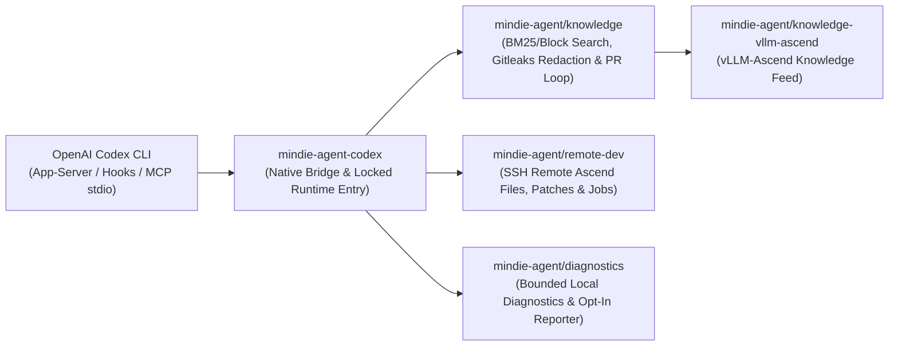

<p align="center">
  
</p>

<h1 align="center">MindIE Agent for OpenAI Codex CLI</h1>

<p align="center">
  <b>Native OpenAI Codex CLI Plugin for Ascend Inference & Operator Engineering</b><br/>
  <sub>On-Demand Domain Knowledge · SSH Remote NPU Execution · Privacy-Gated Experience Loop</sub>
</p>

<p align="center">
  <a href="https://github.com/mindie-agent/mindie-agent-codex/releases"></a>
  <a href="plugins/mindie-agent/harness-compatibility.json"></a>
  <a href="plugins/mindie-agent/pyproject.toml"></a>
  <a href="LICENSE"></a>
</p>

<p align="center">
  <a href="README.md">中文</a> | <b>English</b> ·
  <a href="#quick-start">Quick Start</a> ·
  <a href="#why-use-this-plugin">What Can It Do?</a> ·
  <a href="#everyday-usage--operator-commands">Commands</a> ·
  <a href="#architecture--component-map">Architecture</a> ·
  <a href="docs/README.en.md">Documentation</a>
</p>

---

**MindIE Agent for OpenAI Codex CLI** (`mindie-agent-codex`) is the official native OpenAI Codex CLI plugin for [MindIE Agent](https://github.com/mindie-agent/mindie-agent). Working directly inside your business repository and native Codex sessions, it provides **`vLLM-Ascend` domain knowledge retrieval**, **SSH remote Ascend NPU execution**, and a **privacy-gated experience loop**.

Designed around the [MindIE Agent Engineering Design Principles](https://github.com/mindie-agent/mindie-agent/blob/main/docs/design-principles.en.md), the plugin works on demand with **zero daily activation ceremony**, while keeping all errors and uncertain external effects explicitly visible to the caller.

---

## Why Use This Plugin?

Here are three practical ways `mindie-agent-codex` accelerates daily Ascend inference and `vLLM-Ascend` engineering:

### Scenario 1: Search Verified `vLLM-Ascend` Troubleshooting Cases on Demand (`mindie-knowledge`)
> **The Problem**: Tracking down the exact root cause and environment conditions for an `HCCL` timeout, an `ACL` operator error, a Graph Mode compilation failure, or precision drift across scattered Issues takes hours.  
> **How It Helps**: Paste the error output directly into Codex. The plugin searches locally synced [`knowledge-vllm-ascend`](https://github.com/mindie-agent/knowledge-vllm-ascend) packages using BM25 and block-citation retrieval, returning verified engineering cases with **applicable versions, evidence, and known caveats**.

### Scenario 2: Edit Locally, Build & Test on Remote Ascend NPU Servers (`mindie-remote-dev`)
> **The Problem**: You code on a macOS or Windows laptop while the Ascend NPU environment lives on a remote Linux server. Manually syncing patches and watching long test runs slows down every iteration.  
> **How It Helps**: Ask Codex to *"sync my current patch to the remote Ascend server, run the unit tests, and stream the logs."* The `mindie-remote-dev` MCP server provides editor-grade remote file operations, patching, managed background jobs, live log streaming, and artifact sync over SSH—completely independent of knowledge capture consent.

### Scenario 3: Turn Debugging Sessions into Sanitized Community Knowledge (Opt-In)
> **The Problem**: Hard-won debugging insights usually vanish when a terminal session ends, yet sharing raw transcripts risks exposing internal IPs, keys, or private paths.  
> **How It Helps**: Community sharing is **off by default**. Only when you explicitly opt in for an approved public repository does the plugin extract public conversation messages on `Stop` (or via explicit `history-import`), redact secrets locally with deterministic rules and Gitleaks `8.30.1`, generate block navigation summaries, and open a sanitized GitHub PR.
> - Read the **[Contribution Notice / 用户须知](plugins/mindie-agent/skills/mindie-agent/references/user-notice.md)** for full details on visible-message filtering, redaction limits, and public Git history.
> - For an optional multi-task Git worktree layout for `vllm` and `vllm-ascend`, see **[Workspace Setup](plugins/mindie-agent/skills/mindie-agent/references/workspace-setup.md)** and [vllm-ascend-workspace](https://github.com/mindie-agent/vllm-ascend-workspace).

---

## Quick Start

### Option 1: One-Sentence Install via Your AI Agent (Recommended)

Copy and paste the prompt below directly to your Codex CLI (or any terminal-capable AI Agent) and let it install and verify the plugin for you:

```text
Please install https://github.com/mindie-agent/mindie-agent-codex for me
```

<details open>
<summary>🤖 <b>Automated Installation Protocol for AI Agents (Instructions for AI Agents)</b></summary>

If you are an AI Agent asked by the user to install this plugin, execute the following deterministic steps directly in the terminal **without asking the user to read the documentation manually**:

1. **Check prerequisites and host version**:
   ```sh
   git --version
   uv --version
   codex --version
   ```
   - Verify `codex --version` matches one of the verified host versions for release `v0.0.1` (declared in [`plugins/mindie-agent/harness-compatibility.json`](plugins/mindie-agent/harness-compatibility.json)):
     - macOS: `codex-cli 0.162.0-alpha.17.2`
     - Native Windows / Windows WSL: `codex-cli 0.153.4`
   - On **Linux or Windows WSL**, if the background knowledge service will be used, also run `systemctl --user show --property=Version` to verify `systemd >= 254` with unified cgroup v2 is reachable (inside WSL, use Linux-native `codex`, `git`, and `uv` rather than Windows binaries across `/mnt/c`).

2. **Add the plugin marketplace and install `mindie-agent`**:
   ```sh
   codex plugin marketplace add https://github.com/mindie-agent/mindie-agent-codex.git --ref v0.0.1
   codex plugin add mindie-agent@mindie-agent --json
   ```

3. **Verify the installation record and report back**:
   ```sh
   codex plugin list --json
   ```
   - Confirm `codex plugin list --json` shows `mindie-agent@mindie-agent` version `0.0.1` enabled in the active profile.
   - Inform the user that starting a new native Codex session will trigger `SessionStart` and MCP initialization (building the isolated locked runtime under `PLUGIN_DATA` via `uv sync --locked --no-editable`, with an initial cold-start window of up to 10 minutes) and expose both `mindie-knowledge` and `mindie-remote-dev`.

</details>

### Option 2: One-Line Terminal Install (Manual)

To install manually from a macOS / Linux / WSL shell or native Windows PowerShell:

```sh
codex plugin marketplace add https://github.com/mindie-agent/mindie-agent-codex.git --ref v0.0.1 && \
codex plugin add mindie-agent@mindie-agent --json && \
codex plugin list --json
```

#### Environment Notes
- **Prerequisites**: `git`, `uv`, and an authenticated `codex` CLI with native plugin support.
- **Native Windows**: Git for Windows supplies the SSH client used by `mindie-remote-dev`.
- **Linux & Windows WSL**: Inside WSL, use Linux-native `codex`, `git`, and `uv` with profile, SQLite, and runtime files stored on the Linux filesystem. Service-backed knowledge operations require a reachable `systemd --user` manager (`>= 254`); if unavailable, the knowledge service reports an explicit error while `mindie-remote-dev` continues to work normally.

---

## Everyday Usage & Operator Commands

Ordinary tasks require **no operator commands** (you can also invoke `$mindie-agent` inside a session for interactive setup). To inspect status, update sharing consent, import historical sessions, or manage fault reporting, run `bridge` through the persistent release `entry.py`:

| Action | Command Example | Description |
|---|---|---|
| **Inspect Status** | `python3 <PLUGIN_DATA>/releases/0.0.1/entry.py bridge status` | **Read-only check** of active binding, knowledge service health, capture cursor, and sync state |
| **Configure Sharing Scope** | `python3 <PLUGIN_DATA>/releases/0.0.1/entry.py bridge configure` | Configure or update opt-in community contribution repository, account, and project scope |
| **Enable / Disable Sharing** | `python3 <PLUGIN_DATA>/releases/0.0.1/entry.py bridge sharing-disable` | Immediately stop (or enable via `sharing-enable`) capture and contribution for the configured scope |
| **Refresh Public Feed** | `python3 <PLUGIN_DATA>/releases/0.0.1/entry.py bridge sync` | Trigger an immediate model-free public knowledge feed refresh |
| **Import Historical Session** | `python3 <PLUGIN_DATA>/releases/0.0.1/entry.py bridge history-import --source /path/to/rollout.jsonl` | Redact and import an explicitly selected native JSONL session (see [Historical Contribution](docs/history-import.md)) |
| **Manage Fault Reporting** | `python3 <PLUGIN_DATA>/releases/0.0.1/entry.py bridge reporting-status` | Query or toggle (`reporting-enable` / `reporting-disable`) independent product fault reporting |

### Silent Updates, Uninstall & Known Limitations

- **Silent Compatible Updates**: More than 24 hours after the last successful check, the next natural MCP tool call triggers an asynchronous background check for the highest compatible Release, builds the locked runtime outside the operation lock, and switches atomically when idle while preserving all saved user preferences.
- **Safe Uninstall**: Close active sessions using the plugin and remove it via native Codex CLI:
  ```sh
  codex plugin remove mindie-agent@mindie-agent --json
  ```
- **Known Host Limitation (Child-Agent Cancellation)**: In `0.0.1`, interrupting a spawned child agent turn in Codex does not dispatch the native `Interrupt` event to the child's pending MCP call, which may leave its local helper/SSH process or an already-started remote command running until the host exits (main-thread interrupts clean up local helper trees in ~73ms via the native `Interrupt` hook). See [Harness Interface Evidence — Child-Agent Limitation](docs/harness-interfaces.md#known-limitation-child-agent-cancellation).

---

## Architecture & Component Map

`mindie-agent-codex` is built as a **thin native adapter**: it handles Codex plugin manifests, hook trust CAS updates, main-thread `Interrupt` routing, public `response_item` extraction, and the immutable runtime entry, while delegating core capabilities to shared packages.



| Repository / Component | Responsibility |
|---|---|
| [`mindie-agent/mindie-agent`](https://github.com/mindie-agent/mindie-agent) | Top-level architecture, MindIE Agent Engineering Design Principles, domain boundaries, and paired-release governance. |
| `mindie-agent/mindie-agent-codex` (this repo) | Codex native plugin manifests (`.codex-plugin/`, `plugins/mindie-agent/`), hook trust CAS management, main-thread `Interrupt` cancellation bridge, public transcript parser, and immutable runtime lifecycle. |
| [`mindie-agent/knowledge`](https://github.com/mindie-agent/knowledge) | Shared knowledge core: local SQLite/BM25 search, deterministic redaction, capture queue, block-index scheduling, and GitHub PR publication reconciliation. |
| [`mindie-agent/knowledge-vllm-ascend`](https://github.com/mindie-agent/knowledge-vllm-ascend) | Curated `vllm-ascend` domain knowledge feed (pinned by contract SHA-256 and verified commit in [`product-contract.json`](plugins/mindie-agent/product-contract.json)). |
| [`mindie-agent/remote-dev`](https://github.com/mindie-agent/remote-dev) | Editor-semantics remote file operations, patching, managed background jobs, and live log polling over SSH for Ascend servers. |
| [`mindie-agent/diagnostics`](https://github.com/mindie-agent/diagnostics) | Bounded local diagnostic logs and optional sanitized GitHub Issue fault reporting. |

---

## Developer Verification

From the repository root, provide local checkouts of the pinned `knowledge` and `kimi` repositories to run the preflight and contract test suite:

```sh
export MINDIE_CORE_REPO=/path/to/knowledge-checkout
export MINDIE_KIMI_REPO=/path/to/kimi-adapter-checkout
uv run --project plugins/mindie-agent --no-sync python tests/preflight.py
uv run --project plugins/mindie-agent --no-sync python -m unittest discover -s tests -p 'test_*.py'
```

---

## Documentation Index

Detailed engineering and verification guides are available in [`docs/`](docs/README.en.md) in both English and Chinese:

- **[Documentation Index (English)](docs/README.en.md)** | **[文档索引（中文）](docs/README.md)**
- **Codex Harness Interface Evidence**: [English](docs/harness-interfaces.md) | [中文](docs/harness-interfaces.zh.md) — Registered interfaces in `harness-compatibility.json`, native management, main-thread `Interrupt` hook, and child-agent cancellation limitation.
- **Public Transcript Capture & Redaction**: [English](docs/public-transcript.md) | [中文](docs/public-transcript.zh.md) — Native `response_item` filtering, Gitleaks `8.30.1` scanning, immutable Markdown blocks, and isolated indexing.
- **Explicit Historical Session Import**: [English](docs/history-import.md) | [中文](docs/history-import.zh.md) — Consent verification, incremental redaction, and resumable import for selected historical JSONL transcripts.
- **Installed Service Identity & Continuity**: [English](docs/service-continuity.md) | [中文](docs/service-continuity.zh.md) — Locked runtime outside disposable caches, single canonical binding, and atomic idle cutover.
- **Failure Diagnostics & Cancellation**: [English](docs/failure-diagnostics.md) | [中文](docs/failure-diagnostics.zh.md) — Read-only status checks, local process tree cleanup, and durable remote job separation.
- **Framework Stability & Persistent Config**: [English](docs/framework-stability.md) | [中文](docs/framework-stability.zh.md) — Persistent user preferences across updates, Windows atomic config I/O, and verification boundaries.
- **Test Boundaries & Contracts**: [English](docs/testing-contracts.md) | [中文](docs/testing-contracts.zh.md) — `tests/preflight.py` checks, publication compatibility validation, and contract test matrix.

---

## License

Released under the [MIT License](LICENSE).
