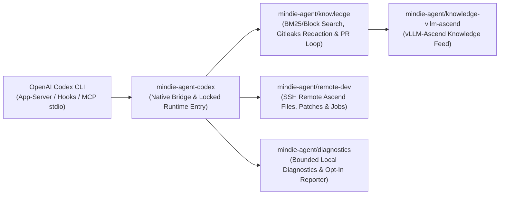

<p align="center">
  
</p>

<h1 align="center">MindIE Agent for OpenAI Codex CLI</h1>

<p align="center">
  <b>Native OpenAI Codex CLI Plugin for the Full Ascend NPU AI Infra Lifecycle</b><br/>
  <sub>Architecture Design · Feature Development · AscendC / Triton Kernels · Remote NPU Testing · Silent Experience Loop</sub>
</p>

<p align="center">
  <a href="https://github.com/mindie-agent/mindie-agent-codex/releases"></a>
  <a href="plugins/mindie-agent/harness-compatibility.json">=0.162.0-alpha.2"></a>
  <a href="plugins/mindie-agent/pyproject.toml"></a>
  <a href="LICENSE"></a>
</p>

<p align="center">
  <a href="README.md">中文</a> | <b>English</b> ·
  <a href="#quick-start">Quick Start</a> ·
  <a href="#why-use-this-plugin-trigger-modes--usage-examples">What Can It Do?</a> ·
  <a href="#everyday-usage--operator-commands-silent-default-on">Commands</a> ·
  <a href="#architecture--component-map">Architecture</a> ·
  <a href="docs/README.en.md">Documentation</a>
</p>

---

**MindIE Agent for OpenAI Codex CLI** (`mindie-agent-codex`) is the native OpenAI Codex CLI plugin for [MindIE Agent](https://github.com/mindie-agent/mindie-agent), supporting the **Ascend NPU AI Infra design, development, and testing lifecycle**. Release `v0.1.38` delivers three core capabilities: **local and community knowledge base retrieval with privacy redaction** (covering `vLLM-Ascend`, `xLLM`, and `MindIE-SD` feature development plus `AscendC` / `Triton` kernel engineering), **remote SSH / Docker development and NPU inspection**, and **unified fault diagnostics with sanitized reporting**; additional Ascend software domains are tracked on the project roadmap.

Designed around the [MindIE Agent Engineering Design Principles](https://github.com/mindie-agent/mindie-agent/blob/main/docs/design-principles.en.md), **every capability runs in Silent Default-On mode**—requiring zero slash or prompt-prefix commands so the Ascend domain Skill, `mindie-tools` (including `L1–L4` `knowledge_*` tools), and `mindie-remote-dev` work out of the box across CLI, Desktop Work mode, Automations, and Subagents while keeping all errors and uncertain external effects explicitly visible to the caller.

---

## Why Use This Plugin? (Trigger Modes & Usage Examples)

MindIE Agent combines **100% silent default-on tools and skills** with **opt-in, scope-gated community contribution**:

| Capability | Trigger Mode | When to Use | How to Use |
| :--- | :--- | :--- | :--- |
| **Experience, Knowledge & Skill System**<br/>(`mindie-knowledge` + `mindie-agent` Skill) | **⚡ Default Auto-Trigger** | When designing Ascend AI Infra features, developing in `vLLM-Ascend` / `xLLM` / `MindIE-SD`, writing `AscendC` / `Triton` kernels, authoring unit/accuracy tests, or tuning performance | **No activation prefix needed**—describe your Ascend task in natural language to invoke `knowledge_query`, `knowledge_explain`, `knowledge_feedback`, `knowledge_distill`, and `knowledge_sync` automatically |
| **Remote Ascend NPU Dev & Testing**<br/>(`mindie-remote-dev` MCP toolset + factual status) | **⚡ Default Auto-Trigger** | When syncing local code/tests to a remote Ascend server/container, running NPU builds/tests, checking `npu-smi`, or streaming long job logs | Just describe the remote task in natural language |
| **Profiling, Simulation, Resource Coordination & Local Diagnostics**<br/>(`mindie-tools` MCP toolset) | **⚡ Default Auto-Trigger** | When running installed `profiler`, `sim`, `debugger`, `coordinator`, `rsi_loop`, or `experiment_ledger` components, inspecting local `diagnostics`, or exporting a support bundle | Call directly in any CLI chat, Desktop Work mode, Automation, or Subagent |
| **Engineering Experience Loop**<br/>(`Stop` Auto-Capture + Gitleaks Redaction) | **🔄 Background Run in Authorized Scope** | When contributing sanitized design, kernel development, testing, or tuning takeaways back to the open-source knowledge base | **Configure Consent Once, Active in Approved `project_roots`**—once contribution is enabled, sessions inside approved `project_roots` are automatically redacted and packaged into a knowledge PR on `Stop`; unconfigured, disabled, or out-of-scope sessions exit `< 100ms` with zero SQLite |

> **Default-On Tool Surface & Component Auto-Updates**:
> - **Out-of-the-Box MCP Discovery**: Both `mindie-remote-dev` and `mindie-tools` (including `knowledge_query`, `knowledge_explain`, `knowledge_feedback`, `knowledge_distill`, `knowledge_sync`, `coordinator`, `profiler`, `debugger`, `sim`, `diagnostics_status`, `diagnostics_bundle`, `rsi_loop`, and `experiment_ledger`) are exposed by default on startup with zero prior session-binding gate.
> - **Zero-Copy `mindie-tools` Delegation**: Delegates directly to installed `mindie-profiler`, `mindie-sim`, `mindie-debugger`, and `mindie-coordinator` CLIs on `PATH` (or explicit virtual-environment bindings in `component_commands`) and the built-in `diagnostics` runtime, preserving exit codes and raw outputs while writing large reports via `--output`.
> - **Seamless Component Auto-Updates**: Background maintenance checks for verified formal Releases of official components installed in the managed runtime or bound via standard Python module entries in `component_commands`, builds a side-by-side candidate runtime, and atomically switches both the interpreter and standard bindings when idle—preserving your knowledge store, consent settings, in-flight work, and any custom wrappers.

### Scenario 1: Natural-Language Feature Design, Kernel Development & Test Authoring (Silent Default-On)
> **The Problem**: Designing new Ascend features, implementing `AscendC` / `Triton` operators, or writing `vLLM-Ascend` accuracy tests often requires domain-specific architecture conventions, kernel constraints, and verified test patterns.  
> **Copy-Paste Example**:
> ```text
> I want to design and implement a custom fused operator in vllm-ascend (with Triton / AscendC kernel support) and add unit + accuracy tests. Please check past experience and architecture conventions to propose an implementation plan.
> ```
> **What Happens**: The plugin automatically applies the `mindie-agent` Skill and searches locally synced [`knowledge-vllm-ascend`](https://github.com/mindie-agent/knowledge-vllm-ascend) packages using BM25 and block-citation retrieval, returning verified engineering cases with **applicable versions, evidence, and known caveats**.

### Scenario 2: Everyday Conversation Automatically Triggers Remote Ascend NPU Dev & Testing (`mindie-remote-dev` Default Auto-Trigger)
> **The Problem**: You code on a macOS or Windows laptop while the Ascend NPU environment lives on a remote Linux server or container. Manually syncing code, compiling kernels, and watching long test runs slows down every iteration.  
> **Copy-Paste Example**:
> ```text
> Connect to the vllm_dev container on my remote 910B server, check current NPU memory usage, and sync my new operator implementation and rotary_embedding tests to run the full pytest verification suite.
> ```
> **What Happens**: The `mindie-remote-dev` MCP server is always on and **triggers automatically by default** whenever your prompt involves remote servers, containers, or NPU commands—providing editor-grade remote file operations, patching, managed background jobs, live log streaming, and artifact sync over SSH, completely independent of knowledge capture consent.

### Scenario 3: Background Experience Capture & Unified Contribution Switch (Zero Daily Overhead)
> **The Problem**: Hard-won design, kernel implementation, testing, or tuning insights usually vanish when a terminal session ends, yet sharing raw transcripts risks exposing internal IPs, keys, or private paths.  
> **Copy-Paste Example (just work on your engineering task normally)**:
> ```text
> Help me complete the build and accuracy alignment verification for this custom Ascend operator using the knowledge base and our remote NPU container, and run the unit test suite.
> ```
> **What Happens**: Community sharing is **off by default**. Once you opt in during setup, your saved consent persists across sessions; in any session inside your approved `project_roots`, every turn end (`Stop`) automatically ensures an active session lease, extracts public conversation messages in the background, redacts secrets locally with deterministic rules and Gitleaks `8.30.1`, generates block navigation summaries, and opens a sanitized GitHub PR—without re-prompting for consent or requiring a closing command (when sharing is unconfigured, disabled, or outside `project_roots`, `Stop` exits in `< 100ms` with zero SQLite writes).
> - **Unified Contribution Switch (`mindie-consent.json` beside the adapter configuration)**: Community knowledge sharing and automatic tool fault reporting share a single persistent choice. Explicitly enabling (`contribute`) configures knowledge sharing and starts the native background reporter; disabling (`disabled`) stops subsequent outgoing sends for both paths. Saved choices (including `disabled`, `read-only`, and `later`) persist across upgrades without re-prompting; only when a legacy knowledge-only `contribute` record returns `needs_choice` does the setup flow ask once to confirm the unified setting (never prompting separately for knowledge vs. fault reporting or per task). The plugin strictly separates **(1) local consent configuration written**, **(2) background reporter worker running**, and **(3) external GitHub Issue/PR created**.
> - Read the **[Contribution Notice / 用户须知](docs/install/user-notice.md)** for full details on visible-message filtering, redaction limits, and public Git history.
> - For an optional multi-task Git worktree layout for `vllm` and `vllm-ascend`, see **[Workspace Setup](docs/install/workspace-setup.md)** and [vllm-ascend-workspace](https://github.com/mindie-agent/vllm-ascend-workspace).

---

## Quick Start

Copy and paste the prompt below directly to your Codex CLI (or any terminal-capable AI Agent) and let it install and verify the plugin for you:

```text
Please install https://github.com/mindie-agent/mindie-agent-codex for me
```

<details>
<summary>🤖 <b>AI Agent install protocol (expand; agents parse and execute this page)</b></summary>

If you are an AI agent asked to install MindIE Agent, execute these steps in order; the user should not need to read the docs manually.

1. **Check base tools and host version (`gh` is optional, never a hard blocker)**:
   ```sh
   git --version
   uv --version
   codex --version
   gh auth status   # optional; failure only changes the recommended privacy mode
   ```
   - Host versions are declared in [`plugins/mindie-agent/harness-compatibility.json`](plugins/mindie-agent/harness-compatibility.json): exactly `0.153.4`, plus `>=0.162.0-alpha.2` and `<=0.999.999` (prereleases included), on macOS, native Windows, and Linux / WSL.
   - When `gh` is installed and authenticated, recommend `contribute`; when it is missing, unauthenticated, or unreachable, recommend `local-only` (local capture, **zero GitHub upload, no `gh` required**). Installation and all local/remote NPU capabilities still work. Never abort installation because `gh` is unavailable.

2. **Run the deterministic bootstrap (one command installs the plugin, preheats the locked runtime, and initializes `codex.json`)**:
   ```sh
   uv run https://github.com/mindie-agent/mindie-agent/releases/latest/download/install.py --host codex
   ```
   - Do not clone manually or assemble `bootstrap.py`/`setup.py` paths; `install.py --host codex` is the only stable entry.
   - Verify with `codex plugin list --json` that `mindie-agent@mindie-agent` version `0.1.38` is enabled.

3. **Show the 3-question dynamic onboarding (use the native Codex `request_user_input`; if unavailable, print numbered options and wait)**:
   1. **Workspace** (`id: "workspace"`): `Initialize vllm-ascend-workspace (Recommended)` / `Keep the current directory` / `Use an existing workspace`.
   2. **Experience & privacy mode** (`id: "privacy_mode"`, ordered by the `gh` probe):
      - `gh` authenticated: `contribute (recommended; community knowledge PRs + sanitized fault reporting)` / `local-only (local only, zero upload)` / `read-only (no capture)`.
      - `gh` unavailable: `local-only (recommended; zero GitHub upload, no gh)` / `contribute (requires gh login)` / `read-only (no capture)`.
   3. **Optional one-step SSH NPU access** (`id: "ssh_npu"`): `Connect now (Recommended)` / `Later`. When chosen, prefer `remote_auth(save_default=True, discover=True)`; in a terminal only, use the command below with `--password` last and keep the leading space so it stays out of shell history:
      ```sh
       <python> -m remote_dev auth setup --host <REAL_IP> --port 22 --user <REAL_USER> --save-default --discover --password
      ```

4. **Apply choices and show the readiness card**:
   - Resolve the workspace, then start with `codex -C "<absolute-path>"`; the absence of Codex.app is not a failure.
   - Persist the privacy choice (`<python>` is the preheated runtime interpreter):
     ```sh
     <python> -m mindie_codex.scripts.setup sharing --enable --project-root "<WORKSPACE_ROOT>"
     <python> -m mindie_codex.scripts.setup sharing --local-only --project-root "<WORKSPACE_ROOT>"
     <python> -m mindie_codex.scripts.setup sharing --disable
     ```
   - If SSH/NPU was selected, run `remote_auth(..., save_default=True, discover=True)` or the terminal command, then run the read-only `mindie_doctor` check and show runtime, config, sharing, and SSH/NPU readiness.
   - Finish with a **single-line, polite, non-pushy** Star postscript (for example, "If this plugin helps, a Star on mindie-agent/mindie-agent is appreciated ⭐"). Only perform the Star action after explicit user consent; never Star silently.
</details>

#### Environment Notes
- **Prerequisites**: `git`, `uv`, and an authenticated `codex` CLI with native plugin support. **`gh` (GitHub CLI) is an optional enhancement** used only by `contribute` mode; without it the plugin selects `local-only`. Host versions follow [`plugins/mindie-agent/harness-compatibility.json`](plugins/mindie-agent/harness-compatibility.json): exact `0.153.4` and `>=0.162.0-alpha.2` (prereleases included, through `0.999.999`) are valid on macOS, native Windows, and Linux / WSL.
- **macOS**: A Homebrew or otherwise installed `codex` CLI is sufficient (`0.153.4` and in-range alphas, including `0.162.0-alpha.2` and `0.164.0-alpha.11.1`). Without Codex.app, open the workspace with `codex -C`; `codex app` is not required.
- **Native Windows**: Git for Windows supplies the SSH client used by `mindie-remote-dev`.
- **Linux & Windows WSL**: Inside WSL, use Linux-native `codex`, `git`, and `uv` (with optional `gh`) and keep profile, SQLite, and runtime files stored on the Linux filesystem. Service-backed knowledge operations require a reachable `systemd --user` manager (`>= 254`); if unavailable, the knowledge service reports an explicit error while `mindie-remote-dev` continues to work normally.

---

## Everyday Usage & Operator Commands (Silent Default-On)

MindIE Agent works directly from **natural-language prompts with zero prefix commands**—operational context is progressively disclosed to the Agent only when needed:

| Scenario | What You Type | What Happens Behind the Scenes |
|---|---|---|
| **Ascend AI Infra Design, Dev (`vLLM-Ascend` / `xLLM` / `MindIE-SD` / `AscendC` / `Triton`), Testing & Tuning** | Describe your design, development, kernel, or testing task directly in natural language | Automatically applies Ascend Skill guidance and `mindie-tools` (`knowledge_*` search + component tools) alongside `mindie-remote-dev` to implement, test, and verify on real NPUs |
| **Checking Status, Changing Sharing Settings, or Importing History** | Ask in natural language (e.g., `"check MindIE status"`, `"enable/disable community sharing"`, `"import past sessions"`) | Your Agent loads the relevant secondary reference context on demand and runs the internal bridge command for you; saved preferences persist across sessions and updates |
| **Everyday Remote Ascend Server / Container Work** | Describe the remote task in natural language | Always-on `mindie-remote-dev` MCP tools trigger automatically to read/edit remote files, apply patches, and stream background job logs |

### Silent Updates, Uninstall & Known Limitations

- **Silent Compatible Updates**: A background maintenance thread checks asynchronously for both the highest compatible plugin Release and formal GitHub Releases of shared runtime components from their official repositories (see [`docs/releases/mindie-agent-codex-0.1.19.md`](docs/releases/mindie-agent-codex-0.1.19.md)), builds a side-by-side locked `uv` runtime outside the operation lock, runs a model-free API probe, and retires the idle service before atomically publishing the binding (never starting a knowledge worker during updates and preserving your saved unified contribution setting and session lease state).
- **Safe Uninstall**: Close active sessions using the plugin and remove it via native Codex CLI:
  ```sh
  codex plugin remove mindie-agent@mindie-agent --json
  ```
- **Known Host Limitation (Child-Agent Cancellation)**: In `0.0.2`, interrupting a spawned child agent turn in Codex does not dispatch the native `Interrupt` event to the child's pending MCP call, which may leave its local helper/SSH process or an already-started remote command running until the host exits (main-thread interrupts clean up local helper trees in ~73ms via the native `Interrupt` hook). See [Harness Interface Evidence — Child-Agent Limitation](docs/harness-interfaces.md#known-limitation-child-agent-cancellation).

---

## Architecture & Component Map

`mindie-agent-codex` is built as a **thin native adapter**: it handles Codex plugin manifests, hook trust CAS updates, main-thread `Interrupt` routing, public `response_item` extraction, and the immutable runtime entry, while delegating core capabilities to shared packages.



| Repository / Component | Responsibility |
|---|---|
| [`mindie-agent/mindie-agent`](https://github.com/mindie-agent/mindie-agent) | Top-level architecture, MindIE Agent Engineering Design Principles, domain boundaries, and paired-release governance. |
| `mindie-agent/mindie-agent-codex` (this repo) | Codex native plugin manifests (`.codex-plugin/`, `plugins/mindie-agent/`), hook trust CAS management, main-thread `Interrupt` cancellation bridge, public transcript parser, and immutable runtime lifecycle. |
| [`mindie-agent/knowledge`](https://github.com/mindie-agent/knowledge) | Shared knowledge core: local SQLite/BM25 search, deterministic redaction, capture queue, block-index scheduling, and GitHub PR publication reconciliation. |
| [`mindie-agent/knowledge-vllm-ascend`](https://github.com/mindie-agent/knowledge-vllm-ascend) | Curated `vllm-ascend` domain knowledge feed. |
| [`mindie-agent/remote-dev`](https://github.com/mindie-agent/remote-dev) | Editor-semantics remote file operations, patching, managed background jobs, and live log polling over SSH for Ascend servers. |
| [`mindie-agent/diagnostics`](https://github.com/mindie-agent/diagnostics) | Bounded local diagnostic logs and optional sanitized GitHub Issue fault reporting. |

---

## Developer Verification

Run the fast, isolated thin-plugin contract suite from the repository root:

```sh
uv run --project plugins/mindie-agent --no-sync python -m pytest -q -m "not live_npu" tests
uv run --project plugins/mindie-agent --no-sync python plugins/mindie-agent/scripts/setup.py release-metadata --source plugins/mindie-agent --tests tests --revision "$(git rev-parse HEAD)"
```

- **Release Microbenchmark**: Each `0.1.38` plugin release attaches `benchmark-results.json` and `benchmark-results.md` measuring the `public-transcript` public-message parsing and hidden-reasoning filtering workload ([`benchmarks/release.json`](benchmarks/release.json)) in `us/op`. This serves as a reproducible CPU microbenchmark baseline, distinct from live A2/A3 NPU acceptance and end-to-end Agent productivity evaluation.

---

## Documentation Index

Detailed engineering and verification guides are available in [`docs/`](docs/README.en.md) in both English and Chinese:

- **[Documentation Index (English)](docs/README.en.md)** | **[文档索引（中文）](docs/README.md)**
- **Codex Harness Interface Evidence**: [English](docs/harness-interfaces.md) | [中文](docs/harness-interfaces.zh.md) — Registered interfaces in `harness-compatibility.json`, native management, main-thread `Interrupt` hook, and child-agent cancellation limitation.
- **Public Transcript Capture & Redaction**: [English](docs/public-transcript.md) | [中文](docs/public-transcript.zh.md) — Native `response_item` filtering, Gitleaks `8.30.1` scanning, immutable Markdown blocks, and isolated indexing.
- **Explicit Historical Session Import**: [English](docs/history-import.md) | [中文](docs/history-import.zh.md) — Consent verification, incremental redaction, and resumable import for selected historical JSONL transcripts.
- **Installed Service Identity & Continuity**: [English](docs/service-continuity.md) | [中文](docs/service-continuity.zh.md) — Locked runtime outside disposable caches, single canonical binding, and atomic idle cutover.
- **Failure Diagnostics & Cancellation**: [English](docs/failure-diagnostics.md) | [中文](docs/failure-diagnostics.zh.md) — Read-only status checks, local process tree cleanup, and durable remote job separation.
- **Framework Stability & Persistent Config**: [English](docs/framework-stability.md) | [中文](docs/framework-stability.zh.md) — Persistent user preferences across updates, Windows atomic config I/O, and verification boundaries.
- **Test Boundaries & Contracts**: [English](docs/testing-contracts.md) | [中文](docs/testing-contracts.zh.md) — `pytest` thin-plugin contracts and publication compatibility validation.

---

## License

Released under the [MIT License](LICENSE).
