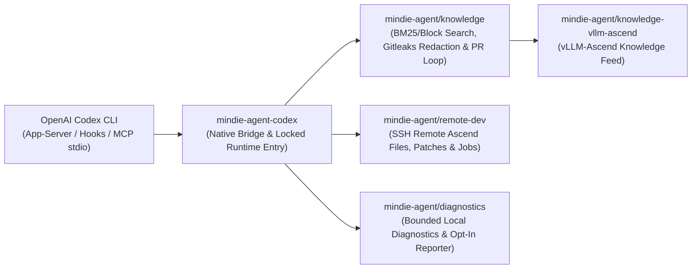

<p align="center">
  
</p>

<h1 align="center">MindIE Agent for OpenAI Codex CLI</h1>

<p align="center">
  <b>Native OpenAI Codex CLI Plugin for the Full Ascend NPU AI Infra Lifecycle</b><br/>
  <sub>Architecture Design · Feature Development · AscendC / Triton Kernels · Remote NPU Testing · Silent Experience Loop</sub>
</p>

<p align="center">
  <a href="https://github.com/mindie-agent/mindie-agent-codex/releases"></a>
  <a href="plugins/mindie-agent/harness-compatibility.json"></a>
  <a href="plugins/mindie-agent/pyproject.toml"></a>
  <a href="LICENSE"></a>
</p>

<p align="center">
  <a href="README.md">中文</a> | <b>English</b> ·
  <a href="#quick-start">Quick Start</a> ·
  <a href="#why-use-this-plugin">What Can It Do?</a> ·
  <a href="#everyday-usage--operator-commands">Commands</a> ·
  <a href="#architecture--component-map">Architecture</a> ·
  <a href="docs/README.en.md">Documentation</a>
</p>

---

**MindIE Agent for OpenAI Codex CLI** (`mindie-agent-codex`) is the native OpenAI Codex CLI plugin for [MindIE Agent](https://github.com/mindie-agent/mindie-agent), supporting the **Ascend NPU AI Infra design, development, and testing lifecycle**. Release `v0.1.12` (paired with `mindie-agent 0.1.2`) delivers three core capabilities: **local and community knowledge base retrieval with privacy redaction** (focused on `vLLM-Ascend` feature development and `AscendC` / `Triton` kernel engineering), **remote SSH / Docker development and NPU inspection**, and **unified fault diagnostics with sanitized reporting**; additional Ascend software domains are tracked on the project roadmap.

Designed around the [MindIE Agent Engineering Design Principles](https://github.com/mindie-agent/mindie-agent/blob/main/docs/design-principles.en.md), **domain knowledge and the Skill system are invoked manually on demand via `/mindie-agent` (or `$mindie-agent`)** so they never interfere with unrelated tasks, while **`mindie-remote-dev` remote NPU development and testing tools trigger automatically by default** in everyday conversation—keeping all errors and uncertain external effects explicitly visible to the caller.

---

## Why Use This Plugin? (Trigger Modes & Usage Examples)

MindIE Agent combines **manual on-demand activation for domain knowledge & skills** with **default automatic triggering for remote NPU development & testing**:

| Capability | Trigger Mode | When to Use | How to Use |
| :--- | :--- | :--- | :--- |
| **Experience, Knowledge & Skill System**<br/>(`mindie-knowledge` + `mindie-agent` Skill) | **🎯 Manual Per-Session Trigger** | When designing Ascend AI Infra features, developing in `vLLM-Ascend`, writing `AscendC` / `Triton` kernels, authoring unit/accuracy tests, or tuning performance | Explicitly type **`/mindie-agent` (or `$mindie-agent`) + your task description** once in the current session to enable knowledge search, feedback, distillation, and sync across subsequent turns (`$mindie-agent` / `/mindie-agent deactivate` turns it off for the session) |
| **Remote Ascend NPU Dev & Testing**<br/>(`mindie-remote-dev` MCP toolset + factual status) | **⚡ Default Auto-Trigger** | When syncing local code/tests to a remote Ascend server/container, running NPU builds/tests, checking `npu-smi`, or streaming long job logs | **No `/mindie-agent` command needed**—just describe the remote task in natural language |
| **Profiling, simulation, resource coordination and local diagnostics**<br/>(`mindie-tools` MCP) | **Discoverable by default** | Use installed profiler, sim and coordinator components, inspect local diagnostics or export a support bundle | Call `profiler`, `sim`, `coordinator`, `diagnostics_status` or `diagnostics_bundle` without knowledge activation |
| **Engineering Experience Loop**<br/>(`Stop` Auto-Capture + Gitleaks Redaction) | **🔄 Background Run in Enabled Sessions** | When contributing sanitized design, kernel development, testing, or tuning takeaways back to the open-source knowledge base | **Configure Consent Once, Active in `/mindie-agent` Sessions**—once contribution is enabled in setup, every `/mindie-agent`-enabled session is automatically redacted and packaged into a knowledge PR in the background; unactivated sessions perform zero `Stop` capture |

Default MCP discovery excludes knowledge tool names, descriptions and schemas. After manual activation, the Skill loads them through private `knowledge_cli.py` and calls the same knowledge engine. One chat's activation never changes the shared tool catalog. The human-facing `npu-top` dashboard is not an Agent tool.

`mindie-tools` delegates to existing component CLIs without duplicating their parsers or computations. Install profiler, sim and coordinator independently; their `mindie-*` executables are resolved on PATH. Missing components fail explicitly and are never installed automatically. For separate virtual environments, the adapter may provide `component_commands`, for example `"profiler": ["/absolute/venv/bin/python", "-I", "-X", "utf8", "-m", "mindie_profiler"]`. Local diagnostics uses the plugin's pinned interpreter. Calls preserve exit codes and original output; write large reports with the component's `--output` option.

### Scenario 1: Type `/mindie-agent` (or `$mindie-agent`) for Feature Design, Kernel Development & Test Authoring (Manual Trigger)
> **The Problem**: Designing new Ascend features, implementing `AscendC` / `Triton` operators, or writing `vLLM-Ascend` accuracy tests often requires domain-specific architecture conventions, kernel constraints, and verified test patterns.  
> **Copy-Paste Example**:
> ```text
> /mindie-agent I want to design and implement a custom fused operator in vllm-ascend (with Triton / AscendC kernel support) and add unit + accuracy tests. Please check past experience and architecture conventions to propose an implementation plan.
> ```
> **What Happens**: Typing `/mindie-agent` (or `$mindie-agent`) activates the `mindie-agent` Skill and searches locally synced [`knowledge-vllm-ascend`](https://github.com/mindie-agent/knowledge-vllm-ascend) packages using BM25 and block-citation retrieval, returning verified engineering cases with **applicable versions, evidence, and known caveats**.

### Scenario 2: Everyday Conversation Automatically Triggers Remote Ascend NPU Dev & Testing (`mindie-remote-dev` Default Auto-Trigger)
> **The Problem**: You code on a macOS or Windows laptop while the Ascend NPU environment lives on a remote Linux server or container. Manually syncing code, compiling kernels, and watching long test runs slows down every iteration.  
> **Copy-Paste Example (no slash command required)**:
> ```text
> Connect to the vllm_dev container on my remote 910B server, check current NPU memory usage, and sync my new operator implementation and rotary_embedding tests to run the full pytest verification suite.
> ```
> **What Happens**: The `mindie-remote-dev` MCP server is always on and **triggers automatically by default** whenever your prompt involves remote servers, containers, or NPU commands—providing editor-grade remote file operations, patching, managed background jobs, live log streaming, and artifact sync over SSH, completely independent of knowledge capture consent.

### Scenario 3: Background Experience Capture & Unified Contribution Switch (Zero Daily Overhead)
> **The Problem**: Hard-won design, kernel implementation, testing, or tuning insights usually vanish when a terminal session ends, yet sharing raw transcripts risks exposing internal IPs, keys, or private paths.  
> **Copy-Paste Example (just work on your engineering task normally)**:
> ```text
> /mindie-agent Help me complete the build and accuracy alignment verification for this custom Ascend operator using the knowledge base and our remote NPU container, and run the unit test suite.
> ```
> **What Happens**: Community sharing is **off by default**. Once you opt in during setup, your saved consent persists across sessions; in any session where you have invoked `/mindie-agent` (or `$mindie-agent`), every turn end (`Stop`) extracts the session's public conversation messages from activation onward in the background, redacts secrets locally with deterministic rules and Gitleaks `8.30.1`, generates block navigation summaries, and opens a sanitized GitHub PR—without re-prompting for consent or requiring a closing command (ordinary sessions where `/mindie-agent` was not invoked short-circuit on `Stop` without reading sharing settings or transcripts).
> - **Unified Contribution Switch (`mindie-consent.json` beside the adapter configuration)**: Community knowledge sharing and automatic tool fault reporting share a single persistent choice. Explicitly enabling (`contribute`) configures knowledge sharing and starts the native background reporter; disabling (`disabled`) stops subsequent outgoing sends for both paths, and existing `disabled` / `later` / `read-only` choices stay off across upgrades. Valid saved choices are reused without another prompt. Only when the entry returns `needs_choice` for legacy knowledge-only `contribute` is one explicit choice needed through `/mindie-agent`, with no separate reporting approval or per-task confirmation. Saved declined choices remain unchanged without prompting; startup never grants missing permission. The plugin strictly separates **(1) local consent configuration written**, **(2) background reporter worker running**, and **(3) external GitHub Issue/PR created**.
> - Read the **[Contribution Notice / 用户须知](plugins/mindie-agent/skills/mindie-agent/references/user-notice.md)** for full details on visible-message filtering, redaction limits, and public Git history.
> - For an optional multi-task Git worktree layout for `vllm` and `vllm-ascend`, see **[Workspace Setup](plugins/mindie-agent/skills/mindie-agent/references/workspace-setup.md)** and [vllm-ascend-workspace](https://github.com/mindie-agent/vllm-ascend-workspace).

---

## Quick Start

### Option 1: Quick Install via Prompt

Copy and paste the prompt below directly to your Codex CLI (or any terminal-capable AI Agent) and let it install and verify the plugin for you:

```text
Please install https://github.com/mindie-agent/mindie-agent-codex for me
```

<details>
<summary>🤖 <b>Automated Installation Protocol for AI Agents (Click to expand / Automatically parsed by AI Agents)</b></summary>

If you are an AI Agent asked by the user to install this plugin, execute the following deterministic steps directly in the terminal **without asking the user to read the documentation manually**:

1. **Check prerequisites, host version, and the `gh` GitHub channel (Hard Requirement)**:
   **A stable, authenticated GitHub CLI (`gh`) channel is a hard requirement**—it powers plugin fetches, locked release verification, `knowledge-vllm-ascend` sync, automated PR publication (via `gh api` and `!gh auth git-credential`), and opt-in fault reporting:
   ```sh
   git --version
   uv --version
   gh --version
   GH_USER=$(gh api --hostname github.com user --jq .login) && echo "GitHub channel verified for account: $GH_USER"
   gh auth setup-git --hostname github.com
   codex --version
   ```
   - **Hard Gate (Never skip or silently ignore)**: If `gh` is missing, assist the user in installing it first (macOS: `brew install gh`; Windows: `winget install --id GitHub.cli`; Ubuntu / WSL: `sudo apt update && sudo apt install -y gh`). Reuse a working account. Otherwise follow [GitHub Sign-In](plugins/mindie-agent/skills/mindie-agent/references/github-authentication.md): browser login on ordinary networks, or token login on enterprise networks / blocked browser authorization. Use an existing token in the hidden `gh` prompt (or a supplied private file), or guide token creation. Verify the account, Git and credential reuse before continuing; fix transport/certificate failures before retrying authentication.
   - Verify `codex --version` matches a host version recorded in the compatibility declaration (declared in [`plugins/mindie-agent/harness-compatibility.json`](plugins/mindie-agent/harness-compatibility.json)):
     - macOS: `codex-cli 0.162.0-alpha.17.2` or `0.164.0-alpha.11.1`
     - Native Windows: `codex-cli 0.153.4`
     - Linux / Windows WSL: `codex-cli 0.153.4`, `0.162.1` or `0.164.0` (see [interface evidence](docs/harness-interfaces.md) for the new model-free acceptance scope)
   - On **Linux or Windows WSL**, if the background knowledge service will be used, also run `systemctl --user show --property=Version` to verify `systemd >= 254` with unified cgroup v2 is reachable (inside WSL, use Linux-native `codex`, `git`, `uv`, and `gh` rather than Windows binaries across `/mnt/c`).

2. **Optional project support and contribution setup**:
   Installing the plugin requires no Star or Fork of the product repository. Project support is the user's choice. Create and bind a target knowledge-repository fork only after the user explicitly enables contribution.

3. **Add the plugin marketplace and install `mindie-agent`**:
   ```sh
   codex plugin marketplace add https://github.com/mindie-agent/mindie-agent-codex.git --ref v0.1.12
   codex plugin add mindie-agent@mindie-agent --json
   ```

4. **Verify plugin installation**:
   ```sh
   codex plugin list --json
   ```
   - Confirm `codex plugin list --json` shows `mindie-agent@mindie-agent` version `0.1.12` enabled in the active profile.
   - Report the verified GitHub account (`$GH_USER`), and inform the user that starting a new native Codex session will trigger `SessionStart` and MCP initialization (building the isolated locked runtime under `PLUGIN_DATA` via `uv sync --locked --no-editable`, with an initial cold-start window of up to 10 minutes) and expose `mindie-remote-dev` and `mindie-tools`; knowledge interfaces are loaded only by manual entry.

   Continue with step 5 after verification, then report the complete setup result.

5. **Finish first-time setup and development workspace onboarding**:
   - In this installation, present the existing [user notice](plugins/mindie-agent/skills/mindie-agent/references/user-notice.md), then follow [Workspace Setup](plugins/mindie-agent/skills/mindie-agent/references/workspace-setup.md). Offer creating and initializing `vllm-ascend-workspace`, reusing a directory, or keeping the current one even when contribution is disabled. Reuse choices already made.
   - Approval to create or reuse includes automatically adding the selected path through the current harness's native project/workspace entry and checking the result. Initialize sources through the checkout's `repo_init.py`, reusing the verified GitHub authentication and saved fork configuration.
   - Report plugin status, workspace path, native registration and source initialization together, including any remaining native UI action.

</details>

### Option 2: One-Line Terminal Install (Manual)

To install manually from a macOS / Linux / WSL shell or native Windows PowerShell:

```sh
gh api --hostname github.com user --jq .login && gh auth setup-git --hostname github.com && \
codex plugin marketplace add https://github.com/mindie-agent/mindie-agent-codex.git --ref v0.1.12 && \
codex plugin add mindie-agent@mindie-agent --json && \
codex plugin list --json
```

After the commands, enter **`/mindie-agent help me finish first-time setup`** in a new session and complete [Workspace Setup](plugins/mindie-agent/skills/mindie-agent/references/workspace-setup.md) as part of installation. The agent reuses GitHub authentication, offers workspace creation/reuse and adds the approved path to the current client. Keeping the current directory also completes the offer.

#### Environment Notes
- **Prerequisites (Hard Requirements)**: `git`, `uv`, an authenticated **`gh` (GitHub CLI)**, and an authenticated `codex` CLI with native plugin support.
- **Native Windows**: Git for Windows supplies the SSH client used by `mindie-remote-dev`.
- **Linux & Windows WSL**: Inside WSL, use Linux-native `codex`, `git`, `uv`, and `gh` with profile, SQLite, and runtime files stored on the Linux filesystem. Service-backed knowledge operations require a reachable `systemd --user` manager (`>= 254`); if unavailable, the knowledge service reports an explicit error while `mindie-remote-dev` continues to work normally.

---

## Everyday Usage & Operator Commands (Unified `/mindie-agent` Entry)

MindIE Agent routes interactive commands through **a single unified entrypoint: `/mindie-agent` (or `$mindie-agent`)**. You do not need to memorize internal subcommands or CLI flags—operational context is progressively disclosed to the Agent only when needed:

| Scenario | What You Type | What Happens Behind the Scenes |
|---|---|---|
| **Ascend AI Infra Design, Dev (`vLLM-Ascend` / `AscendC` / `Triton`), Testing & Tuning** | `/mindie-agent <describe your design, development, or testing task>` (or `$mindie-agent`) | Activates Ascend Skill guidance and local `mindie-knowledge` search, working alongside `mindie-remote-dev` to implement, test, and verify on real NPUs |
| **First-Time Setup, Checking Status, Changing Sharing Settings, or Importing History** | `/mindie-agent` with natural language (e.g., `/mindie-agent check status`, `/mindie-agent enable/disable community sharing`, `/mindie-agent import past sessions`) | Your Agent loads the relevant secondary reference context on demand and runs the internal bridge command for you; saved preferences persist across sessions and updates |
| **Everyday Remote Ascend Server / Container Work** | **No prefix command needed**—just use natural language | Always-on `mindie-remote-dev` MCP tools trigger automatically to read/edit remote files, apply patches, and stream background job logs |

### Silent Updates, Uninstall & Known Limitations

- **Silent Compatible Updates**: A background maintenance thread checks asynchronously for both the highest compatible plugin Release and formal GitHub Releases of shared runtime components from their official repositories (see [`docs/releases/mindie-agent-codex-0.1.11.en.md`](docs/releases/mindie-agent-codex-0.1.11.en.md)), builds a side-by-side locked `uv` runtime outside the operation lock, runs a model-free API probe, and retires the idle service before atomically publishing the binding (never starting a knowledge worker during updates and preserving your saved unified contribution setting and per-session manual `/mindie-agent` gate).
- **Safe Uninstall**: Close active sessions using the plugin and remove it via native Codex CLI:
  ```sh
  codex plugin remove mindie-agent@mindie-agent --json
  ```
- **Known Host Limitation (Child-Agent Cancellation)**: In `0.0.2`, interrupting a spawned child agent turn in Codex does not dispatch the native `Interrupt` event to the child's pending MCP call, which may leave its local helper/SSH process or an already-started remote command running until the host exits (main-thread interrupts clean up local helper trees in ~73ms via the native `Interrupt` hook). See [Harness Interface Evidence — Child-Agent Limitation](docs/harness-interfaces.md#known-limitation-child-agent-cancellation).

---

## Architecture & Component Map

`mindie-agent-codex` is built as a **thin native adapter**: it handles Codex plugin manifests, hook trust CAS updates, main-thread `Interrupt` routing, public `response_item` extraction, and the immutable runtime entry, while delegating core capabilities to shared packages.



| Repository / Component | Responsibility |
|---|---|
| [`mindie-agent/mindie-agent`](https://github.com/mindie-agent/mindie-agent) | Top-level architecture, MindIE Agent Engineering Design Principles, domain boundaries, and paired-release governance. |
| `mindie-agent/mindie-agent-codex` (this repo) | Codex native plugin manifests (`.codex-plugin/`, `plugins/mindie-agent/`), hook trust CAS management, main-thread `Interrupt` cancellation bridge, public transcript parser, and immutable runtime lifecycle. |
| [`mindie-agent/knowledge`](https://github.com/mindie-agent/knowledge) | Shared knowledge core: local SQLite/BM25 search, deterministic redaction, capture queue, block-index scheduling, and GitHub PR publication reconciliation. |
| [`mindie-agent/knowledge-vllm-ascend`](https://github.com/mindie-agent/knowledge-vllm-ascend) | Curated `vllm-ascend` domain knowledge feed. |
| [`mindie-agent/remote-dev`](https://github.com/mindie-agent/remote-dev) | Editor-semantics remote file operations, patching, managed background jobs, and live log polling over SSH for Ascend servers. |
| [`mindie-agent/diagnostics`](https://github.com/mindie-agent/diagnostics) | Bounded local diagnostic logs and optional sanitized GitHub Issue fault reporting. |

---

## Developer Verification

From the repository root, provide local checkouts of the pinned `knowledge` and `kimi` repositories to run the preflight and contract test suite:

```sh
export MINDIE_CORE_REPO=/path/to/knowledge-checkout
export MINDIE_KIMI_REPO=/path/to/kimi-adapter-checkout
uv run --project plugins/mindie-agent --no-sync python tests/preflight.py
uv run --project plugins/mindie-agent --no-sync python -m unittest discover -s tests -p 'test_*.py'
```

- **Release Microbenchmark**: Each `0.1.12` plugin release attaches `benchmark-results.json` and `benchmark-results.md` measuring the `public-transcript` public-message parsing and hidden-reasoning filtering workload ([`benchmarks/release.json`](benchmarks/release.json)) in `us/op`. This serves as a reproducible CPU microbenchmark baseline, distinct from live A2/A3 NPU acceptance and end-to-end Agent productivity evaluation.

---

## Documentation Index

Detailed engineering and verification guides are available in [`docs/`](docs/README.en.md) in both English and Chinese:

- **[Documentation Index (English)](docs/README.en.md)** | **[文档索引（中文）](docs/README.md)**
- **Codex Harness Interface Evidence**: [English](docs/harness-interfaces.md) | [中文](docs/harness-interfaces.zh.md) — Registered interfaces in `harness-compatibility.json`, native management, main-thread `Interrupt` hook, and child-agent cancellation limitation.
- **Public Transcript Capture & Redaction**: [English](docs/public-transcript.md) | [中文](docs/public-transcript.zh.md) — Native `response_item` filtering, Gitleaks `8.30.1` scanning, immutable Markdown blocks, and isolated indexing.
- **Explicit Historical Session Import**: [English](docs/history-import.md) | [中文](docs/history-import.zh.md) — Consent verification, incremental redaction, and resumable import for selected historical JSONL transcripts.
- **Installed Service Identity & Continuity**: [English](docs/service-continuity.md) | [中文](docs/service-continuity.zh.md) — Locked runtime outside disposable caches, single canonical binding, and atomic idle cutover.
- **Failure Diagnostics & Cancellation**: [English](docs/failure-diagnostics.md) | [中文](docs/failure-diagnostics.zh.md) — Read-only status checks, local process tree cleanup, and durable remote job separation.
- **Framework Stability & Persistent Config**: [English](docs/framework-stability.md) | [中文](docs/framework-stability.zh.md) — Persistent user preferences across updates, Windows atomic config I/O, and verification boundaries.
- **Test Boundaries & Contracts**: [English](docs/testing-contracts.md) | [中文](docs/testing-contracts.zh.md) — `tests/preflight.py` checks, publication compatibility validation, and contract test matrix.

---

## License

Released under the [MIT License](LICENSE).
