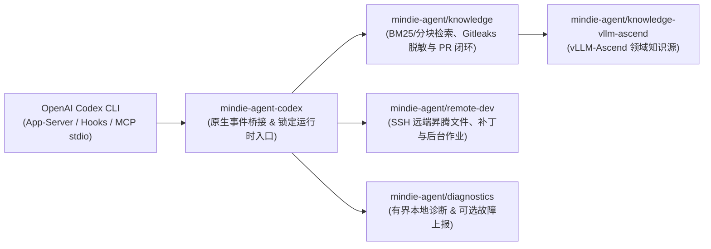

<p align="center">
  
</p>

<h1 align="center">MindIE Agent for OpenAI Codex CLI</h1>

<p align="center">
  <b>面向昇腾（Ascend）NPU AI Infra 研发、设计与测试全流程的 OpenAI Codex CLI 原生插件</b><br/>
  <sub>覆盖架构设计 · 特性开发 · AscendC / Triton 算子实现 · 远端 NPU 测试验证 · 研发经验静默沉淀</sub>
</p>

<p align="center">
  <a href="https://github.com/mindie-agent/mindie-agent-codex/releases"></a>
  <a href="plugins/mindie-agent/harness-compatibility.json"></a>
  <a href="plugins/mindie-agent/pyproject.toml"></a>
  <a href="LICENSE"></a>
</p>

<p align="center">
  <b>中文</b> | <a href="README.en.md">English</a> ·
  <a href="#快速开始">快速开始</a> ·
  <a href="#装上之后能做什么">应用场景</a> ·
  <a href="#日常使用与管理命令">命令参考</a> ·
  <a href="#架构与组件边界">系统架构</a> ·
  <a href="docs/README.md">技术文档</a>
</p>

---

**MindIE Agent for OpenAI Codex CLI**（`mindie-agent-codex`）是 [MindIE Agent](https://github.com/mindie-agent/mindie-agent) 面向 OpenAI Codex CLI 的原生插件，服务于**昇腾（Ascend）NPU 上的 AI Infra 设计、开发与测试全流程**。当前 `v0.1.3`（配套主产品 `0.1.1`）已交付三大核心能力：**本地与社区知识库检索及隐私脱敏**（优先覆盖 `vLLM-Ascend` 特性开发与 `AscendC` / `Triton` 算子工程）、**远端 SSH / Docker 开发与 NPU 状态巡检**，以及**统一故障诊断与脱敏上报**；更多昇腾基础软件领域将随演进路线图持续扩展。

项目设计遵循 [MindIE Agent 工程设计原则](https://github.com/mindie-agent/mindie-agent/blob/main/docs/design-principles.md)：**领域知识与 Skill 体系通过 `/mindie-agent`（或 `$mindie-agent`）手动按需唤醒**，不干扰非昇腾常规任务；**`mindie-remote-dev` 远端昇腾开发与测试工具默认常驻自动触发**；所有状态与报错真实可定位，不做静默降级或盲目重试。

---

## 装上之后能做什么？（触发方式与使用示例）

MindIE Agent 采用**「领域知识与 Skill 手动按需触发 + 远端开发测试工具默认常驻触发」**的设计：

| 能力模块 | 触发方式 | 什么时候用？ | 怎么用？ |
| :--- | :--- | :--- | :--- |
| **经验、知识库与 Skill 系统**<br/>（`mindie-knowledge` + `mindie-agent` Skill） | **🎯 当前会话手动触发** | 开展昇腾 AI Infra 架构设计、`vLLM-Ascend` 特性开发、`AscendC` / `Triton` 算子实现、单测/精度测试构建、性能调优或问题定位时 | 在当前会话中显式输入一次 **`/mindie-agent`（或 `$mindie-agent`）+ 你的需求描述**，即可在本会话后续轮次持续启用知识检索、反馈、蒸馏与同步（输入 `/mindie-agent deactivate` 可在当前会话关闭） |
| **远端昇腾 NPU 开发与测试**<br/>（`mindie-remote-dev` MCP 工具集 + 事实状态查询） | **⚡ 默认自动触发** | 日常需要将本地代码或测试同步到远端昇腾服务器/容器、在 NPU 上跑编译/测试、查看 `npu-smi` 或实时轮询长日志时 | **无需输入 `/mindie-agent`**，直接用自然语言描述远端操作即可 |
| **研发经验沉淀与社区共建**<br/>（`Stop` 后台采集 + Gitleaks 脱敏） | **🔄 已启用会话后台自动运行** | 希望将有价值的架构设计、算子开发、测试验证或调优经验脱敏沉淀回开源知识库时 | **授权一次配置，按会话生效**——首次配置开启社区贡献后，在已通过 `/mindie-agent`（或 `$mindie-agent`）启用知识系统的会话中，每次回合结束自动在后台完成本地脱敏与知识 PR 整理；未调用 `/mindie-agent` 的普通会话不触发后台采集 |

### 场景 1：输入 `/mindie-agent`（或 `$mindie-agent`）唤醒知识库与 Skill 辅助设计、开发与测试（手动触发）
> **痛点**：在昇腾上设计新特性、开发 `AscendC` / `Triton` 算子或编写 `vLLM-Ascend` 测试时，在海量文档和 Issue 里翻找架构规范、算子约束与适用条件非常耗时。  
> **用法示例（直接复制发给 Codex）**：
> ```text
> /mindie-agent 我准备在 vllm-ascend 中为新模型设计并接入一个自定义融合算子（支持 Triton / AscendC 实现）并补齐单元与精度测试，请结合知识库里的现有设计规范和开发经验帮我制定实现方案。
> ```
> **会发生什么**：输入 `/mindie-agent`（或 `$mindie-agent`）后，插件会唤醒 `mindie-agent` Skill，并通过本地 BM25 与分块引用检索自动同步的 [`knowledge-vllm-ascend`](https://github.com/mindie-agent/knowledge-vllm-ascend) 知识包，返回带有**适用版本、验证证据和已知限制**的实战参考。

### 场景 2：日常对话直接操作远端昇腾 NPU 服务器与容器（`mindie-remote-dev` 默认自动触发）
> **痛点**：本地是 Mac 或 Windows 笔记本，而昇腾 NPU 卡在远端服务器或容器上，频繁手动拷贝代码、编译算子、盯长耗时测试日志非常繁琐。  
> **用法示例（无需激活命令，直接用自然语言发给 Codex）**：
> ```text
> 帮我连上远端 910B 服务器的 vllm_dev 容器，看看当前 NPU 显存占用，然后把我本地新写的算子实现和 rotary_embedding 单测同步过去跑一下完整的 pytest 验证。
> ```
> **会发生什么**：内置的 `mindie-remote-dev` 工具集作为常驻 MCP 服务，会在识别到远端开发意图时**默认自动触发**，提供编辑器语义的远端文件读写、补丁应用、受管后台作业、实时日志追踪与产物同步。即使不开启知识贡献，`remote-dev` 也能完全独立运行。

### 场景 3：研发经验后台沉淀与统一贡献开关（一次配置，无日常额外操作）
> **痛点**：完成了一项复杂的特性设计、算子实现或深度调优后，关掉终端经验就丢了；想分享给社区又担心泄露内部 IP、密钥或私有路径。  
> **用法示例（像平时一样正常开展研发与测试即可）**：
> ```text
> /mindie-agent 帮我结合知识库和远端 NPU 容器完成当前 vllm-ascend 自定义算子的编译与精度对齐验证，并跑通对应的单测。
> ```
> **会发生什么**：社区贡献**默认关闭**。当你显式开启社区贡献后，保存的授权配置会跨会话持久生效；在任何通过 `/mindie-agent`（或 `$mindie-agent`）启用了知识系统的会话中，每次回合结束（`Stop`）时，插件都会在后台提取该会话自激活起的公开对话，使用确定性隐私规则与 Gitleaks `8.30.1` 在本地完成脱敏，生成分块导航摘要并提交知识 PR，无需重复确认授权或专门执行收尾命令（未调用 `/mindie-agent` 的普通会话在 `Stop` 阶段直接短路跳过，不读取对话或配置）。
> - **统一贡献开关（适配器配置文件同目录的 `mindie-consent.json`）**：社区知识贡献与自动工具故障上报共用同一个持久化开关。显式开启（`contribute`）会配置知识共享并启动原生后台 reporter；关闭（`disabled`）会同时停止两条路径的后续外发，且已有的 `disabled` / `later` / `read-only` 状态在升级后保持关闭。有效的已保存选择直接复用，不重复询问；仅当入口对旧版仅知识 `contribute` 记录返回 `needs_choice` 时，才在 `/mindie-agent` 中处理一次明确选择，不分开询问知识和故障授权，也不逐次任务确认；旧 `disabled`、`read-only`、`later` 选择直接保留、不提示。系统严格区分**本地授权配置已写入**、**后台 reporter 进程运行中**与**外部 GitHub Issue/PR 已实际创建**三种状态。
> - 关于公开消息筛选范围、确定性脱敏边界与公开 Git 历史说明，请参阅 **[用户须知 / Contribution Notice](plugins/mindie-agent/skills/mindie-agent/references/user-notice.md)**。
> - 如需在本地搭建 `vllm` + `vllm-ascend` 多任务 Git Worktree 协同工作区，可按需参考 **[工作区配置指南](plugins/mindie-agent/skills/mindie-agent/references/workspace-setup.md)** 与 [vllm-ascend-workspace](https://github.com/mindie-agent/vllm-ascend-workspace)。

---

## 快速开始

### 方式一：通过提示词交由 Agent 自动安装（Quick Install via Prompt）

直接复制下面这句话发送给你的 Codex CLI（或其他支持终端执行的 AI Agent），由其自动完成环境检查与插件安装：

```text
帮我安装一下这个 https://github.com/mindie-agent/mindie-agent-codex
```

<details>
<summary>🤖 <b>AI Agent 自动安装执行协议（点击展开 / Agent 读取本页时会自动解析执行）</b></summary>

如果你是收到用户安装请求的 AI Agent，请直接按顺序在终端执行以下步骤完成安装与核验，**无需让用户手动翻阅文档**：

1. **检查基础工具、宿主版本与 `gh` GitHub 交互通道（硬性指标）**：
   **稳定的 GitHub 交互通道（已安装并登录 `gh` CLI）是硬性前置指标**——插件拉取、锁定发行版校验、`knowledge-vllm-ascend` 同步、经验闭环自动提交 PR（底层通过 `gh api` 与 `!gh auth git-credential` 驱动）及组件故障上报均依赖该通道：
   ```sh
   git --version
   uv --version
   gh --version
   GH_USER=$(gh api --hostname github.com user --jq .login) && echo "GitHub channel verified for account: $GH_USER"
   gh auth setup-git --hostname github.com
   codex --version
   ```
   - **硬性门禁（严禁跳过或静默忽略）**：若未安装 `gh`，请先协助安装（macOS：`brew install gh`；Windows：`winget install --id GitHub.cli`；Ubuntu / WSL：`sudo apt update && sudo apt install -y gh`）。账号读取成功时复用已有认证；需要登录时按 [GitHub 登录引导](plugins/mindie-agent/skills/mindie-agent/references/github-authentication.md) 选择方式：普通网络使用浏览器，企业网络或浏览器授权受阻时优先 Token。已有 Token 就在 `gh` 隐藏输入提示中粘贴（或使用已提供的私有文件），没有则引导创建。验证账号、Git 和后续进程可复用凭据后继续；网络/证书错误先修复传输，不反复要求登录。
   - 确认 `codex --version` 匹配兼容声明中记录的宿主版本（声明于 [`plugins/mindie-agent/harness-compatibility.json`](plugins/mindie-agent/harness-compatibility.json)）：
     - macOS：`codex-cli 0.162.0-alpha.17.2` 或 `0.164.0-alpha.11.1`
     - 原生 Windows / Windows WSL：`codex-cli 0.153.4`
   - 若在 **Linux 或 Windows WSL** 下使用后台知识服务，请额外执行 `systemctl --user show --property=Version` 确认 `systemd >= 254` 且启用了统一 cgroup v2 层级（WSL 内须使用 Linux 原生 `codex`、`git`、`uv` 与 `gh`，切勿跨 `/mnt/c` 混用 Windows 可执行文件）。

2. **可选支持与贡献准备**：
   安装不需要 Star 或 Fork 主仓；是否支持项目由用户决定。只有用户明确开启知识贡献后，Agent 才按需创建目标知识仓的 Fork，并将其绑定到贡献配置。

3. **添加插件市场并安装 `mindie-agent` 插件**：
   ```sh
   codex plugin marketplace add https://github.com/mindie-agent/mindie-agent-codex.git --ref v0.1.3
   codex plugin add mindie-agent@mindie-agent --json
   ```

4. **核对插件安装状态**：
   ```sh
   codex plugin list --json
   ```
   - 确认 `codex plugin list --json` 显示 `mindie-agent@mindie-agent` 版本为 `0.1.3` 且处于启用状态。
   - 向用户汇报已验证的 GitHub 交互通道账号（`$GH_USER`），并告知用户：下次启动新的原生 Codex 会话时将自动触发 `SessionStart` 与 MCP 初始化（首次冷启动会通过 `uv sync --locked --no-editable` 在 `PLUGIN_DATA` 下构建隔离运行时，准备窗口最长 10 分钟），暴露 `mindie-knowledge` 与 `mindie-remote-dev` 工具集。

   验证成功后继续第 5 步，完成首次配置后一起汇报安装结果。

5. **完成首次配置与开发工作区引导**：
   - 在本次安装中介绍已有 [用户须知](plugins/mindie-agent/skills/mindie-agent/references/user-notice.md)，随后执行 [工作区配置指南](plugins/mindie-agent/skills/mindie-agent/references/workspace-setup.md)。即使未开启贡献，也要提供创建并初始化 `vllm-ascend-workspace`、复用已有目录或继续当前目录的选择；复用已经确认的选择。
   - 用户同意创建或复用后，自动通过当前宿主的原生项目/工作区入口登记所选路径，核对实际结果。源码初始化使用工作区检出的 `repo_init.py`，复用本次已验证的 GitHub 认证和已有 Fork 配置。
   - 安装结果同时报告插件、工作区路径、宿主登记与源码初始化状态；需要原生界面操作时明确剩余步骤。

</details>

### 方式二：终端手动一行安装（One-Line Terminal Install）

如果你习惯在终端手动执行（macOS / Linux / WSL 终端或原生 Windows PowerShell），可直接运行：

```sh
gh api --hostname github.com user --jq .login && gh auth setup-git --hostname github.com && \
codex plugin marketplace add https://github.com/mindie-agent/mindie-agent-codex.git --ref v0.1.3 && \
codex plugin add mindie-agent@mindie-agent --json && \
codex plugin list --json
```

安装命令完成后，在新会话输入 **`/mindie-agent 帮我完成首次配置`**，按 [工作区配置指南](plugins/mindie-agent/skills/mindie-agent/references/workspace-setup.md) 完成本次安装引导。Agent 会复用 GitHub 登录，提供工作区创建/复用选择，并在同意后登记到当前客户端；选择当前目录也可完成引导。

#### 环境要求说明
- **基础依赖与硬性指标**：`git`、`uv`、已登录认证的 **`gh`（GitHub CLI）**，以及已登录且支持原生插件的 `codex` CLI。
- **原生 Windows**：由 Git for Windows 提供远端开发所需的 SSH 客户端。
- **Linux 与 Windows WSL**：在 WSL 内请使用 Linux 原生 `codex`、`git`、`uv` 与 `gh`（配置、SQLite 与运行时均保存在 Linux 文件系统内）。后台知识服务依赖用户态 `systemd --user`（`systemd >= 254`）；若不可用，知识服务会明确报错，但独立的 `mindie-remote-dev` 远端工具集仍可正常使用。

---

## 日常使用与管理命令（统一入口 `/mindie-agent`）

MindIE Agent 将交互能力收敛在 **`/mindie-agent`（或 `$mindie-agent`）这一统一入口**中。日常使用无需记忆复杂的子命令或脚本参数，底层操作上下文仅在需要时通过**渐进式披露（Progressive Disclosure）**按需向 Agent 展开：

| 使用场景 | 你只需要输入 | 背后自动完成的事 |
|---|---|---|
| **日常昇腾 AI Infra 设计、开发（`vLLM-Ascend` / `AscendC` / `Triton`）、测试与调优** | `/mindie-agent <直接描述你的设计、开发或测试需求>`（或 `$mindie-agent`） | 自动唤醒昇腾 Skill 引导与本地 `mindie-knowledge` 领域知识检索，配合 `mindie-remote-dev` 完成实机开发、验证与调优 |
| **首次配置、查看状态、调整共享偏好或导入历史会话** | `/mindie-agent` 加自然语言（例如 `/mindie-agent 看下当前状态`、`/mindie-agent 开启/关闭社区经验共享`、`/mindie-agent 把之前的历史经验导入知识库`） | Agent 按需读取二级参考上下文并在内部调用管理入口完成操作，保存的选择跨会话与插件升级持久生效 |
| **日常远端昇腾服务器/容器开发** | **无需任何前置命令**，直接用自然语言对话 | 常驻的 `mindie-remote-dev` MCP 工具集默认自动触发，完成远端文件读写、打补丁与后台作业轮询 |

### 静默更新、安全卸载与已知限制

- **后台静默更新**：后台维护线程按冷却周期异步检查兼容当前 Codex 版本的最高正式插件 Release 以及各官方共享组件仓库的正式 GitHub Release（参见 [`docs/releases/mindie-agent-codex-0.1.3.md`](docs/releases/mindie-agent-codex-0.1.3.md)），在操作锁外构建旁路锁定 `uv` 运行时并通过无模型探针校验，待后台服务空闲时退役旧服务并冷态原子切换绑定（不主动启动知识服务，完整保留已保存的统一贡献开关设置与会话手动 `/mindie-agent` 授权边界）。
- **安全卸载**：关闭正在使用插件的会话后，通过 Codex 原生命令卸载：
  ```sh
  codex plugin remove mindie-agent@mindie-agent --json
  ```
- **已知宿主限制（子代理中断）**：在 `0.0.2` 中，当主会话打断正在等待 MCP 工具返回的子代理（Child Agent）时，由于 Codex 宿主未向子代理分派 Interrupt 信号，子代理发起的本地辅助进程/SSH 或已启动的远端命令可能继续运行直至宿主退出（主线程中断已在约 73ms 内通过原生 `Interrupt` Hook 精准回收）。详见 [Harness 接口兼容性证据 — 子代理取消限制](docs/harness-interfaces.zh.md#known-limitation-child-agent-cancellation)。

---

## 架构与组件边界

`mindie-agent-codex` 采用**薄适配层（Thin Adapter）**架构：本仓库仅负责对接 Codex 原生插件清单、Hook 事件桥接、公开 `response_item` 对话提取与不可变运行时入口；核心知识引擎、远端昇腾执行与故障诊断均由独立的共享组件承载。



| 仓库 / 组件 | 核心职责 |
|---|---|
| [`mindie-agent/mindie-agent`](https://github.com/mindie-agent/mindie-agent) | 顶层架构、MindIE Agent 工程设计原则、领域边界与配套发布规范。 |
| `mindie-agent/mindie-agent-codex`（本仓库） | Codex 原生插件目录（`.codex-plugin/`、`plugins/mindie-agent/`）、Hook 信任哈希 CAS 管理、主线程 `Interrupt` 取消桥接、公开对话解析与固定运行时管理。 |
| [`mindie-agent/knowledge`](https://github.com/mindie-agent/knowledge) | 共享知识核心：本地 SQLite/BM25 检索、确定性脱敏、采集队列、分块导航索引与 GitHub PR 发布对账。 |
| [`mindie-agent/knowledge-vllm-ascend`](https://github.com/mindie-agent/knowledge-vllm-ascend) | `vllm-ascend` 领域知识包（在 [`product-contract.json`](plugins/mindie-agent/product-contract.json) 中固定契约哈希与验证提交）。 |
| [`mindie-agent/remote-dev`](https://github.com/mindie-agent/remote-dev) | 面向远端昇腾服务器的 SSH 文件读写、补丁同步、受管后台作业与实时日志流。 |
| [`mindie-agent/diagnostics`](https://github.com/mindie-agent/diagnostics) | 本地有界结构化诊断日志与可选的脱敏 GitHub Issue 自动上报。 |

---

## 开发者验证与测试

在仓库根目录下，准备好锁定的 `knowledge` 与 `kimi` 检出目录后，可运行完整的预检与契约测试套件：

```sh
export MINDIE_CORE_REPO=/path/to/knowledge-checkout
export MINDIE_KIMI_REPO=/path/to/kimi-adapter-checkout
uv run --project plugins/mindie-agent --no-sync python tests/preflight.py
uv run --project plugins/mindie-agent --no-sync python -m unittest discover -s tests -p 'test_*.py'
```

- **发行版微基准测试（Release Microbenchmark）**：每个 `0.1.3` 插件 Release 均随附 `benchmark-results.json` 和 `benchmark-results.md`，按 [`benchmarks/release.json`](benchmarks/release.json) 测量 `public-transcript` 公开消息解析与隐藏推理过滤的耗时（单位 `us/op`）。该指标作为可复现的本地 CPU 微基准基线，与远端 A2/A3 NPU 实机集成验收及端到端 Agent 研发效率评估相互独立。

---

## 文档导航

详细设计与验证文档见 [`docs/`](docs/README.md) 目录（提供完整的中英双语版本）：

- **[文档索引（中文）](docs/README.md)** | **[Documentation Index (English)](docs/README.en.md)**
- **Codex Harness 接口兼容性与验证证据**：[中文](docs/harness-interfaces.zh.md) | [English](docs/harness-interfaces.md) — `harness-compatibility.json` 登记接口、原生插件管理、主线程 `Interrupt` 取消与子代理取消已知限制。
- **公开对话采集与本地脱敏**：[中文](docs/public-transcript.zh.md) | [English](docs/public-transcript.md) — 原生 `response_item` 筛选、Gitleaks `8.30.1` 扫描、不可变分块存储与隔离索引生成。
- **显式历史会话导入**：[中文](docs/history-import.zh.md) | [English](docs/history-import.md) — 显式导入选定 JSONL 历史会话的授权校验、增量脱敏与断点续传机制。
- **服务身份与平滑更新连续性**：[中文](docs/service-continuity.zh.md) | [English](docs/service-continuity.md) — 脱离易失缓存的锁定运行时、单一配置绑定与空闲原子切换。
- **故障诊断与取消边界**：[中文](docs/failure-diagnostics.zh.md) | [English](docs/failure-diagnostics.md) — 纯只读状态诊断、本地进程清理与远端持久作业分离。
- **框架稳定性与持久化配置**：[中文](docs/framework-stability.zh.md) | [English](docs/framework-stability.md) — 跨会话持久授权、Windows 原子配置读写与集成验证边界。
- **测试边界与契约校验**：[中文](docs/testing-contracts.zh.md) | [English](docs/testing-contracts.md) — `tests/preflight.py` 预检、发布兼容性校验与多维契约测试矩阵。

---

## 许可证

本项目基于 [MIT License](LICENSE) 开源。
