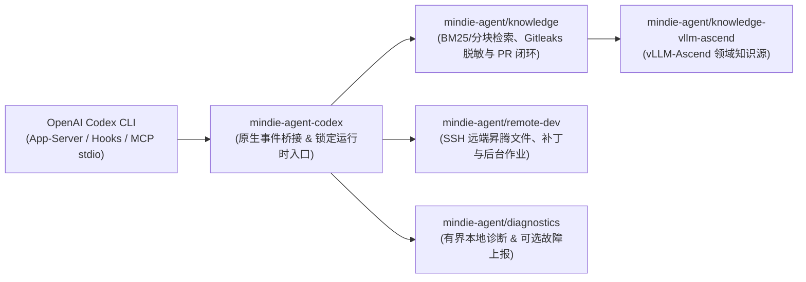

<p align="center">
  
</p>

<h1 align="center">MindIE Agent for OpenAI Codex CLI</h1>

<p align="center">
  <b>面向昇腾（Ascend）推理与算子工程的 OpenAI Codex CLI 原生插件</b><br/>
  <sub>按需领域知识检索 · SSH 远端 NPU 开发调试 · 隐私受控的经验沉淀闭环</sub>
</p>

<p align="center">
  <a href="https://github.com/mindie-agent/mindie-agent-codex/releases"></a>
  <a href="plugins/mindie-agent/harness-compatibility.json"></a>
  <a href="plugins/mindie-agent/pyproject.toml"></a>
  <a href="LICENSE"></a>
</p>

<p align="center">
  <b>中文</b> | <a href="README.en.md">English</a> ·
  <a href="#快速开始">快速开始</a> ·
  <a href="#装上之后能做什么">应用场景</a> ·
  <a href="#日常使用与管理命令">命令参考</a> ·
  <a href="#架构与组件边界">系统架构</a> ·
  <a href="docs/README.md">技术文档</a>
</p>

---

**MindIE Agent for OpenAI Codex CLI**（`mindie-agent-codex`）是 [MindIE Agent](https://github.com/mindie-agent/mindie-agent) 面向 OpenAI Codex CLI 打造的原厂插件。它直接在你的业务仓库和原生 Codex 会话中提供 **`vLLM-Ascend` 领域知识检索**、**SSH 远端昇腾 NPU 执行**以及**隐私受控的经验闭环**。

项目设计遵循 [MindIE Agent 工程设计原则](https://github.com/mindie-agent/mindie-agent/blob/main/docs/design-principles.md)：平时在业务仓库里启动 Codex 写代码、查问题、跑测试**不需要任何前置激活或收尾命令**，所有工具按需介入；报错真实可定位，不做静默降级或黑盒重试。

---

## 装上之后能做什么？

在昇腾推理与 `vLLM-Ascend` 日常开发中，你可以直接用自然语言让 Codex 配合本插件完成以下工作：

### 场景 1：排障时按需检索 `vLLM-Ascend` 实战案例（`mindie-knowledge`）
> **痛点**：遇到 `HCCL` 通信超时、`ACL` 算子报错、图模式（Graph Mode）编译异常或精度问题时，在海量 Issue 和文档里翻找适用条件非常耗时。  
> **怎么做**：直接把报错信息发给 Codex。插件会通过本地 BM25 与分块引用检索自动同步的 [`knowledge-vllm-ascend`](https://github.com/mindie-agent/knowledge-vllm-ascend) 知识包，返回带有**适用版本、验证证据和已知限制**的实战排障参考。

### 场景 2：本地写代码，一键在远端昇腾 NPU 服务器上编译与跑测（`mindie-remote-dev`）
> **痛点**：本地是 Mac 或 Windows 笔记本，而昇腾 NPU 卡在远端服务器上，频繁手动拷贝代码、同步补丁、盯长耗时测试日志极其繁琐。  
> **怎么做**：直接对 Codex 说 *“把当前补丁同步到远端昇腾服务器，跑一下对应的单元测试并实时看日志”*。内置的 `mindie-remote-dev` 工具集提供编辑器语义的远端文件读写、补丁应用、受管后台作业、实时日志追踪与产物同步。即使不开启知识贡献，`remote-dev` 也能完全独立运行。

### 场景 3：将踩坑经验安全脱敏后沉淀为开源社区知识（可选 Opt-in）
> **痛点**：花半天定位完一个棘手的算子或推理 Bug，关掉终端后排障思路就丢了；想分享给社区又担心泄露内部 IP、密钥或私有路径。  
> **怎么做**：社区贡献**默认关闭**。仅在你显式对指定公开仓库开启共享后，插件会在会话结束（`Stop`）或显式导入历史会话（`history-import`）时提取公开对话，使用确定性隐私规则与 Gitleaks `8.30.1` 在本地完成脱敏，生成分块导航摘要并自动提交知识 PR。
> - 关于公开消息筛选范围、确定性脱敏边界与公开 Git 历史说明，请参阅 **[用户须知 / Contribution Notice](plugins/mindie-agent/skills/mindie-agent/references/user-notice.md)**。
> - 如需在本地搭建 `vllm` + `vllm-ascend` 多任务 Git Worktree 协同工作区，可按需参考 **[工作区配置指南](plugins/mindie-agent/skills/mindie-agent/references/workspace-setup.md)** 与 [vllm-ascend-workspace](https://github.com/mindie-agent/vllm-ascend-workspace)。

---

## 快速开始

### 方式一：直接把链接发给你的 Agent 自动安装（推荐）

直接复制下面这句话发送给你的 Codex CLI（或其他支持终端执行的 AI Agent），让它自动帮你完成环境检查与插件安装：

```text
帮我安装一下这个 https://github.com/mindie-agent/mindie-agent-codex
```

<details open>
<summary>🤖 <b>AI Agent 自动安装执行协议（Instructions for AI Agents）</b></summary>

如果你是收到用户安装请求的 AI Agent，请直接按顺序在终端执行以下步骤完成安装与核验，**无需让用户手动翻阅文档**：

1. **检查基础工具与宿主版本**：
   ```sh
   git --version
   uv --version
   codex --version
   ```
   - 确认 `codex --version` 匹配当前发行版 `v0.0.1` 已验证的宿主版本（声明于 [`plugins/mindie-agent/harness-compatibility.json`](plugins/mindie-agent/harness-compatibility.json)）：
     - macOS：`codex-cli 0.162.0-alpha.17.2`
     - 原生 Windows / Windows WSL：`codex-cli 0.153.4`
   - 若在 **Linux 或 Windows WSL** 下使用后台知识服务，请额外执行 `systemctl --user show --property=Version` 确认 `systemd >= 254` 且启用了统一 cgroup v2 层级（WSL 内须使用 Linux 原生 `codex`、`git` 与 `uv`，切勿跨 `/mnt/c` 混用 Windows 可执行文件）。

2. **添加插件市场并安装 `mindie-agent` 插件**：
   ```sh
   codex plugin marketplace add https://github.com/mindie-agent/mindie-agent-codex.git --ref v0.0.1
   codex plugin add mindie-agent@mindie-agent --json
   ```

3. **核对安装状态并向用户汇报**：
   ```sh
   codex plugin list --json
   ```
   - 确认 `codex plugin list --json` 显示 `mindie-agent@mindie-agent` 版本为 `0.0.1` 且处于启用状态。
   - 告知用户：下次启动新的原生 Codex 会话时将自动触发 `SessionStart` 与 MCP 初始化（首次冷启动会通过 `uv sync --locked --no-editable` 在 `PLUGIN_DATA` 下构建隔离运行时，准备窗口最长 10 分钟），并暴露 `mindie-knowledge` 与 `mindie-remote-dev` 工具集。

</details>

### 方式二：终端手动一行安装（One-Line Terminal Install）

如果你习惯在终端手动执行（macOS / Linux / WSL 终端或原生 Windows PowerShell），可直接运行：

```sh
codex plugin marketplace add https://github.com/mindie-agent/mindie-agent-codex.git --ref v0.0.1 && \
codex plugin add mindie-agent@mindie-agent --json && \
codex plugin list --json
```

#### 环境要求说明
- **基础依赖**：`git`、`uv` 以及已登录且支持原生插件的 `codex` CLI。
- **原生 Windows**：由 Git for Windows 提供远端开发所需的 SSH 客户端。
- **Linux 与 Windows WSL**：在 WSL 内请使用 Linux 原生 `codex`、`git` 与 `uv`（配置、SQLite 与运行时均保存在 Linux 文件系统内）。后台知识服务依赖用户态 `systemd --user`（`systemd >= 254`）；若不可用，知识服务会明确报错，但独立的 `mindie-remote-dev` 远端工具集仍可正常使用。

---

## 日常使用与管理命令

安装完成后，**日常研发任务无需执行任何额外命令**（也可在会话中通过 `$mindie-agent` 唤起配置向导）。当你需要查看运行状态、修改贡献范围、导入历史会话或管理故障上报时，可通过持久化入口 `entry.py` 调用 `bridge` 子命令：

| 操作场景 | 命令示例 | 用途说明 |
|---|---|---|
| **查看运行状态** | `python3 <PLUGIN_DATA>/releases/0.0.1/entry.py bridge status` | **纯只读查询**：查看插件绑定、后台知识服务健康度、采集游标与同步状态 |
| **配置/修改共享范围** | `python3 <PLUGIN_DATA>/releases/0.0.1/entry.py bridge configure` | 配置或更新公开社区贡献的目标仓库、账号与本地项目根目录范围 |
| **开启/关闭社区贡献** | `python3 <PLUGIN_DATA>/releases/0.0.1/entry.py bridge sharing-disable` | 立即停止（或通过 `sharing-enable` 开启）已配置项目范围的对话采集与贡献 |
| **手动同步公共知识包** | `python3 <PLUGIN_DATA>/releases/0.0.1/entry.py bridge sync` | 立即执行一次无模型的公共知识源增量同步 |
| **显式导入历史会话** | `python3 <PLUGIN_DATA>/releases/0.0.1/entry.py bridge history-import --source /path/to/rollout.jsonl` | 将用户显式指定的历史 Codex JSONL 会话脱敏并导入经验闭环（详见 [历史会话导入](docs/history-import.zh.md)） |
| **管理产品故障上报** | `python3 <PLUGIN_DATA>/releases/0.0.1/entry.py bridge reporting-status` | 查询或切换（`reporting-enable` / `reporting-disable`）独立的产品故障上报开关 |

### 静默更新、安全卸载与已知限制

- **后台静默更新**：距上次成功检查超过 24 小时后，下一次正常调用 MCP 工具时会在后台异步检查兼容当前 Codex 版本的最高正式 Release，在操作锁外完成运行时构建并于服务空闲时原子切换，完整保留已保存的贡献授权与故障上报设置。
- **安全卸载**：关闭正在使用插件的会话后，通过 Codex 原生命令卸载：
  ```sh
  codex plugin remove mindie-agent@mindie-agent --json
  ```
- **已知宿主限制（子代理中断）**：在 `0.0.1` 中，当主会话打断正在等待 MCP 工具返回的子代理（Child Agent）时，由于 Codex 宿主未向子代理分派 Interrupt 信号，子代理发起的本地辅助进程/SSH 或已启动的远端命令可能继续运行直至宿主退出（主线程中断已在约 73ms 内通过原生 `Interrupt` Hook 精准回收）。详见 [Harness 接口兼容性证据 — 子代理取消限制](docs/harness-interfaces.zh.md#known-limitation-child-agent-cancellation)。

---

## 架构与组件边界

`mindie-agent-codex` 采用**薄适配层（Thin Adapter）**架构：本仓库仅负责对接 Codex 原生插件清单、Hook 事件桥接、公开 `response_item` 对话提取与不可变运行时入口；核心知识引擎、远端昇腾执行与故障诊断均由独立的共享组件承载。



| 仓库 / 组件 | 核心职责 |
|---|---|
| [`mindie-agent/mindie-agent`](https://github.com/mindie-agent/mindie-agent) | 顶层架构、MindIE Agent 工程设计原则、领域边界与配套发布规范。 |
| `mindie-agent/mindie-agent-codex`（本仓库） | Codex 原生插件目录（`.codex-plugin/`、`plugins/mindie-agent/`）、Hook 信任哈希 CAS 管理、主线程 `Interrupt` 取消桥接、公开对话解析与固定运行时管理。 |
| [`mindie-agent/knowledge`](https://github.com/mindie-agent/knowledge) | 共享知识核心：本地 SQLite/BM25 检索、确定性脱敏、采集队列、分块导航索引与 GitHub PR 发布对账。 |
| [`mindie-agent/knowledge-vllm-ascend`](https://github.com/mindie-agent/knowledge-vllm-ascend) | `vllm-ascend` 领域知识包（在 [`product-contract.json`](plugins/mindie-agent/product-contract.json) 中固定契约哈希与验证提交）。 |
| [`mindie-agent/remote-dev`](https://github.com/mindie-agent/remote-dev) | 面向远端昇腾服务器的 SSH 文件读写、补丁同步、受管后台作业与实时日志流。 |
| [`mindie-agent/diagnostics`](https://github.com/mindie-agent/diagnostics) | 本地有界结构化诊断日志与可选的脱敏 GitHub Issue 自动上报。 |

---

## 开发者验证与测试

在仓库根目录下，准备好锁定的 `knowledge` 与 `kimi` 检出目录后，可运行完整的预检与契约测试套件：

```sh
export MINDIE_CORE_REPO=/path/to/knowledge-checkout
export MINDIE_KIMI_REPO=/path/to/kimi-adapter-checkout
uv run --project plugins/mindie-agent --no-sync python tests/preflight.py
uv run --project plugins/mindie-agent --no-sync python -m unittest discover -s tests -p 'test_*.py'
```

---

## 文档导航

详细设计与验证文档见 [`docs/`](docs/README.md) 目录（提供完整的中英双语版本）：

- **[文档索引（中文）](docs/README.md)** | **[Documentation Index (English)](docs/README.en.md)**
- **Codex Harness 接口兼容性与验证证据**：[中文](docs/harness-interfaces.zh.md) | [English](docs/harness-interfaces.md) — `harness-compatibility.json` 登记接口、原生插件管理、主线程 `Interrupt` 取消与子代理取消已知限制。
- **公开对话采集与本地脱敏**：[中文](docs/public-transcript.zh.md) | [English](docs/public-transcript.md) — 原生 `response_item` 筛选、Gitleaks `8.30.1` 扫描、不可变分块存储与隔离索引生成。
- **显式历史会话导入**：[中文](docs/history-import.zh.md) | [English](docs/history-import.md) — 显式导入选定 JSONL 历史会话的授权校验、增量脱敏与断点续传机制。
- **服务身份与平滑更新连续性**：[中文](docs/service-continuity.zh.md) | [English](docs/service-continuity.md) — 脱离易失缓存的锁定运行时、单一配置绑定与空闲原子切换。
- **故障诊断与取消边界**：[中文](docs/failure-diagnostics.zh.md) | [English](docs/failure-diagnostics.md) — 纯只读状态诊断、本地进程清理与远端持久作业分离。
- **框架稳定性与持久化配置**：[中文](docs/framework-stability.zh.md) | [English](docs/framework-stability.md) — 跨会话持久授权、Windows 原子配置读写与集成验证边界。
- **测试边界与契约校验**：[中文](docs/testing-contracts.zh.md) | [English](docs/testing-contracts.md) — `tests/preflight.py` 预检、发布兼容性校验与多维契约测试矩阵。

---

## 许可证

本项目基于 [MIT License](LICENSE) 开源。
