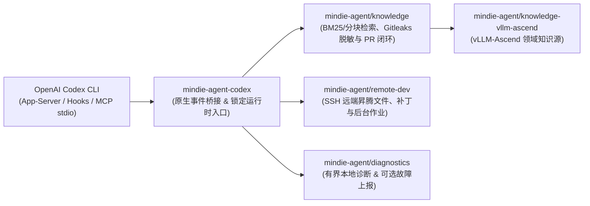

<p align="center">
  
</p>

<h1 align="center">MindIE Agent for OpenAI Codex CLI</h1>

<p align="center">
  <b>面向昇腾（Ascend）NPU AI Infra 研发、设计与测试全流程的 OpenAI Codex CLI 原生插件</b><br/>
  <sub>覆盖架构设计 · 特性开发 · AscendC / Triton 算子实现 · 远端 NPU 测试验证 · 研发经验静默沉淀</sub>
</p>

<p align="center">
  <a href="https://github.com/mindie-agent/mindie-agent-codex/releases"></a>
  <a href="plugins/mindie-agent/harness-compatibility.json">=0.162.0-alpha.2"></a>
  <a href="plugins/mindie-agent/pyproject.toml"></a>
  <a href="LICENSE"></a>
</p>

<p align="center">
  <b>中文</b> | <a href="README.en.md">English</a> ·
  <a href="#快速开始">快速开始</a> ·
  <a href="#装上之后能做什么触发方式与使用示例">应用场景</a> ·
  <a href="#日常使用与管理命令静默默认启用">命令参考</a> ·
  <a href="#架构与组件边界">系统架构</a> ·
  <a href="docs/README.md">技术文档</a>
</p>

---

**MindIE Agent for OpenAI Codex CLI**（`mindie-agent-codex`）是 [MindIE Agent](https://github.com/mindie-agent/mindie-agent) 面向 OpenAI Codex CLI 的原生插件，服务于**昇腾（Ascend）NPU 上的 AI Infra 设计、开发与测试全流程**。当前 `v0.1.39` 已交付三大核心能力：**本地与社区知识库检索及隐私脱敏**（覆盖 `vLLM-Ascend`、`xLLM`、`MindIE-SD` 特性开发与 `AscendC` / `Triton` 算子工程）、**远端 SSH / Docker 开发与 NPU 状态巡检**，以及**统一故障诊断与脱敏上报**；更多昇腾基础软件领域将随演进路线图持续扩展。

项目设计遵循 [MindIE Agent 工程设计原则](https://github.com/mindie-agent/mindie-agent/blob/main/docs/design-principles.md)：**全部能力采用静默默认启用（Silent Default-On）设计**——无需输入任何斜杠或前缀命令，领域 Skill、`mindie-tools`（含 `L1–L4` 知识工具）与 `mindie-remote-dev` 均开箱即用；所有状态与报错真实可定位，不做静默降级或盲目重试。

---

## 装上之后能做什么？（触发方式与使用示例）

MindIE Agent 采用**「100% 静默默认启用 + 社区贡献显式授权按范围采集」**的设计：

| 能力模块 | 触发方式 | 什么时候用？ | 怎么用？ |
| :--- | :--- | :--- | :--- |
| **经验、知识库与 Skill 系统**<br/>（`mindie-knowledge` + `mindie-agent` Skill） | **⚡ 默认自动触发** | 开展昇腾 AI Infra 架构设计、`vLLM-Ascend` / `xLLM` / `MindIE-SD` 特性开发、`AscendC` / `Triton` 算子实现、单测/精度测试构建、性能调优或问题定位时 | **无需输入任何激活前缀**，直接用自然语言描述昇腾任务即可自动调用 `knowledge_query`、`knowledge_explain`、`knowledge_feedback`、`knowledge_distill` 与 `knowledge_sync` |
| **远端昇腾 NPU 开发与测试**<br/>（`mindie-remote-dev` MCP 工具集 + 事实状态查询） | **⚡ 默认自动触发** | 日常需要将本地代码或测试同步到远端昇腾服务器/容器、在 NPU 上跑编译/测试、查看 `npu-smi` 或实时轮询长日志时 | 直接用自然语言描述远端操作即可 |
| **Profiling、仿真、资源协调与本地诊断**<br/>（`mindie-tools` MCP 工具集） | **⚡ 默认自动触发** | 调用已安装的 `profiler`、`sim`、`debugger`、`coordinator`、`rsi_loop`、`experiment_ledger`，或查看本地 `diagnostics` 状态与导出诊断包 | 直接在任意会话、Desktop Work 模式、自动化任务或子代理中调用 |
| **研发经验沉淀与社区共建**<br/>（`Stop` 后台采集 + Gitleaks 脱敏） | **🔄 已授权目录后台自动运行** | 希望将有价值的架构设计、算子开发、测试验证或调优经验脱敏沉淀回开源知识库时 | **授权一次配置，在批准项目目录内自动生效**——开启社区贡献后，处于已批准 `project_roots` 内的会话在回合结束自动完成本地脱敏与知识 PR 整理；未开启或目录外的会话 `< 100ms` 零 SQLite 直接退出 |

> **默认启用工具面与组件自动更新说明**：
> - **全量 MCP 工具开箱即用**：`mindie-remote-dev` 与 `mindie-tools`（含 `knowledge_query`、`knowledge_explain`、`knowledge_feedback`、`knowledge_distill`、`knowledge_sync`、`coordinator`、`profiler`、`debugger`、`sim`、`diagnostics_status`、`diagnostics_bundle`、`rsi_loop`、`experiment_ledger`）在启动时即默认暴露，无需任何前置会话绑定门禁。
> - **`mindie-tools` 零拷贝桥接**：直接复用 `PATH`（或适配器配置 `component_commands` 中显式指定的独立虚拟环境解释器）下的 `mindie-profiler`、`mindie-sim`、`mindie-debugger`、`mindie-coordinator` 与内置 `diagnostics`，完整保留原始退出码与输出，大体积报告直接通过组件的 `--output` 落盘。
> - **共享组件平滑自动更新**：后台维护机制会自动检查受管运行时中已安装的官方组件及 `component_commands` 标准模块绑定的最新正式版 Release，在旁路构建并通过校验后，趁空闲时将标准命令与解释器原子切换至新版本（保留你的本地知识库、授权设置与在途任务，也不会覆盖自定义 wrapper）。

### 场景 1：自然语言直接唤醒知识库与 Skill 辅助设计、开发与测试（静默默认启用）
> **痛点**：在昇腾上设计新特性、开发 `AscendC` / `Triton` 算子或编写 `vLLM-Ascend` 测试时，在海量文档和 Issue 里翻找架构规范、算子约束与适用条件非常耗时。  
> **用法示例（直接复制发给 Codex）**：
> ```text
> 我准备在 vllm-ascend 中为新模型设计并接入一个自定义融合算子（支持 Triton / AscendC 实现）并补齐单元与精度测试，请结合知识库里的现有设计规范和开发经验帮我制定实现方案。
> ```
> **会发生什么**：插件自动匹配昇腾领域 `mindie-agent` Skill，并通过本地 BM25 与分块引用检索自动同步的 [`knowledge-vllm-ascend`](https://github.com/mindie-agent/knowledge-vllm-ascend) 等知识包，返回带有**适用版本、验证证据和已知限制**的实战参考。

### 场景 2：日常对话直接操作远端昇腾 NPU 服务器与容器（`mindie-remote-dev` 默认自动触发）
> **痛点**：本地是 Mac 或 Windows 笔记本，而昇腾 NPU 卡在远端服务器或容器上，频繁手动拷贝代码、编译算子、盯长耗时测试日志非常繁琐。  
> **用法示例（无需激活命令，直接用自然语言发给 Codex）**：
> ```text
> 帮我连上远端 910B 服务器的 vllm_dev 容器，看看当前 NPU 显存占用，然后把我本地新写的算子实现和 rotary_embedding 单测同步过去跑一下完整的 pytest 验证。
> ```
> **会发生什么**：内置的 `mindie-remote-dev` 工具集作为常驻 MCP 服务，会在识别到远端开发意图时**默认自动触发**，提供编辑器语义的远端文件读写、补丁应用、受管后台作业、实时日志追踪与产物同步。即使不开启知识贡献，`remote-dev` 也能完全独立运行。

### 场景 3：研发经验后台沉淀与统一贡献开关（一次配置，无日常额外操作）
> **痛点**：完成了一项复杂的特性设计、算子实现或深度调优后，关掉终端经验就丢了；想分享给社区又担心泄露内部 IP、密钥或私有路径。  
> **用法示例（像平时一样正常开展研发与测试即可）**：
> ```text
> 帮我结合知识库和远端 NPU 容器完成当前 vllm-ascend 自定义算子的编译与精度对齐验证，并跑通对应的单测。
> ```
> **会发生什么**：社区贡献**默认关闭**。当你显式开启社区贡献后，保存的授权配置会跨会话持久生效；在处于已批准 `project_roots` 内的会话中，每次回合结束（`Stop`）时，插件都会自动确保活动租约并在后台提取公开对话，使用确定性隐私规则与 Gitleaks `8.30.1` 在本地完成脱敏，生成分块导航摘要并提交知识 PR，无需重复确认授权或专门执行收尾命令（未配置、已关闭或处于授权目录外的会话在 `Stop` 阶段 `< 100ms` 零 SQLite 直接退出）。
> - **统一贡献开关（适配器配置文件同目录的 `mindie-consent.json`）**：社区知识贡献与自动工具故障上报共用同一个持久化开关。显式开启（`contribute`）会配置知识共享并启动原生后台 reporter；关闭（`disabled`）会同时停止两条路径的后续外发。已保存的有效设置（包括 `disabled` / `read-only` / `later`）在升级后直接沿用、不重复弹窗；仅当检测到旧版仅知识 `contribute` 记录返回 `needs_choice` 时，才需要确认一次统一选择（不会分开询问知识与故障授权，也不会在每次任务中重复确认）。系统严格区分**本地授权配置已写入**、**后台 reporter 进程运行中**与**外部 GitHub Issue/PR 已实际创建**三种状态。
> - 关于公开消息筛选范围、确定性脱敏边界与公开 Git 历史说明，请参阅 **[用户须知 / Contribution Notice](docs/install/user-notice.md)**。
> - 如需在本地搭建 `vllm` + `vllm-ascend` 多任务 Git Worktree 协同工作区，可按需参考 **[工作区配置指南](docs/install/workspace-setup.md)** 与 [vllm-ascend-workspace](https://github.com/mindie-agent/vllm-ascend-workspace)。

---

## 快速开始

直接复制下面这句话发送给你的 Codex CLI（或其他支持终端执行的 AI Agent），由其自动完成环境检查与插件安装：

```text
帮我安装一下这个 https://github.com/mindie-agent/mindie-agent-codex
```

<details>
<summary>🤖 <b>AI Agent 自动安装执行协议（点击展开 / Agent 读取本页时会自动解析执行）</b></summary>

如果你是收到用户安装请求的 AI Agent，请直接按顺序执行以下步骤，**无需让用户手动翻阅文档**：

1. **检查基础工具与宿主版本（`gh` 可选，绝不是硬性门禁）**：
   ```sh
   git --version
   uv --version
   codex --version
   gh auth status   # 可选；失败不阻塞安装，只影响推荐隐私模式
   ```
   - 宿主版本以 [`plugins/mindie-agent/harness-compatibility.json`](plugins/mindie-agent/harness-compatibility.json) 为准：精确 `0.153.4`，以及 `>=0.162.0-alpha.2` 且 `<=0.999.999`（含预发布），在 macOS、原生 Windows、Linux / WSL 上均有效。
   - `gh` 已安装并登录时，后续推荐 `contribute`；未安装、未登录或网络不可达时，自动推荐 `local-only`（本地采集、**零 GitHub 上传、无需 `gh`**），安装与全部本地/远端 NPU 能力照常可用。不得因缺少 `gh` 中止安装。

2. **执行确定性 bootstrap（一条命令完成安装、锁定运行时预热与 `codex.json` 初始化）**：
   ```sh
   uv run https://github.com/mindie-agent/mindie-agent/releases/latest/download/install.py --host codex
   ```
   - 不要手工 clone 或拼接 `bootstrap.py`/`setup.py` 路径；`install.py --host codex` 是唯一稳定入口。
   - 完成后用 `codex plugin list --json` 确认 `mindie-agent@mindie-agent` 版本为 `0.1.39` 且已启用。

3. **弹出 3 问动态 Onboarding（必须使用 OpenAI Codex 原生 `request_user_input`；若当前模式未暴露该工具，则输出编号选项等待用户回复）**：
   1. **工作区**（`id: "workspace"`）：`初始化 vllm-ascend-workspace (Recommended)` / `保持当前目录` / `使用已有工作区目录`。
   2. **经验与隐私模式**（`id: "privacy_mode"`，按第 1 步 `gh` 探测结果动态排序）：
      - `gh` 已认证：`contribute（推荐；社区知识 PR + 脱敏故障上报）` / `local-only（仅本地，零上传）` / `read-only（不采集）`。
      - `gh` 不可用：`local-only（推荐；零 GitHub 上传、无需 gh）` / `contribute（需先登录 gh）` / `read-only（不采集）`。
   3. **可选的一步 SSH NPU 接入**（`id: "ssh_npu"`）：`现在接入（Recommended）` / `稍后`。选择现在时优先调用 `remote_auth(save_default=True, discover=True)`；仅终端场景使用下方命令，`--password` 必须放在最后并保留行首空格，避免进入 shell 历史：
      ```sh
       <python> -m remote_dev auth setup --host <REAL_IP> --port 22 --user <REAL_USER> --save-default --discover --password
      ```

4. **应用选择并展示就绪卡片**：
   - 工作区确定后以 `codex -C "<absolute-path>"` 启动；没有 Codex.app 不算失败。
   - 按第 2 问写入持久选择（`<python>` 为已预热运行时解释器）：
     ```sh
     <python> -m mindie_codex.scripts.setup sharing --enable --project-root "<WORKSPACE_ROOT>"
     <python> -m mindie_codex.scripts.setup sharing --local-only --project-root "<WORKSPACE_ROOT>"
     <python> -m mindie_codex.scripts.setup sharing --disable
     ```
   - 第 3 问选择接入时执行 `remote_auth(..., save_default=True, discover=True)` 或终端命令，然后运行只读 `mindie_doctor` 健康检查，向用户展示运行时、配置、共享模式与 SSH/NPU 就绪状态。
   - 最后以**单行、礼貌、非强制**的 Star 附言收尾（例如“如果这个插件对你有帮助，欢迎给 mindie-agent/mindie-agent 点个 Star ⭐”）；只有用户明确同意才执行 Star 动作，绝不静默 Star。
</details>

#### 环境要求说明
- **基础依赖**：`git`、`uv`，以及已登录且支持原生插件的 `codex` CLI；**`gh`（GitHub CLI）为可选增强**——仅 `contribute` 模式需要，缺失时自动使用 `local-only`。宿主版本以 [`plugins/mindie-agent/harness-compatibility.json`](plugins/mindie-agent/harness-compatibility.json) 为准：精确 `0.153.4` 与 `>=0.162.0-alpha.2`（含预发布，至 `0.999.999`）在 macOS、原生 Windows、Linux / WSL 上均有效。
- **macOS**：Homebrew 或其他方式安装的 `codex` CLI 即可（`0.153.4` 与上述范围内的 alpha，含 `0.162.0-alpha.2`、`0.164.0-alpha.11.1`）。没有 Codex.app 时，工作区用 `codex -C`，不要求 `codex app`。
- **原生 Windows**：由 Git for Windows 提供远端开发所需的 SSH 客户端。
- **Linux 与 Windows WSL**：在 WSL 内请使用 Linux 原生 `codex`、`git`、`uv`（`gh` 可选）（配置、SQLite 与运行时均保存在 Linux 文件系统内）。后台知识服务依赖用户态 `systemd --user`（`systemd >= 254`）；若不可用，知识服务会明确报错，但独立的 `mindie-remote-dev` 远端工具集仍可正常使用。

---

## 日常使用与管理命令（静默默认启用）

MindIE Agent 采用**全自动自然语言交互**——日常使用无需输入任何斜杠前缀或记忆子命令参数，底层操作上下文通过**渐进式披露（Progressive Disclosure）**按需向 Agent 展开：

| 使用场景 | 你只需要输入 | 背后自动完成的事 |
|---|---|---|
| **日常昇腾 AI Infra 设计、开发（`vLLM-Ascend` / `xLLM` / `MindIE-SD` / `AscendC` / `Triton`）、测试与调优** | 直接用自然语言描述你的设计、开发、算子或测试需求 | 自动匹配昇腾 Skill 工作流与 `mindie-tools`（含 `knowledge_*` 领域知识检索），配合 `mindie-remote-dev` 完成实机开发、验证与调优 |
| **查看状态、调整共享偏好或导入历史会话** | 直接用自然语言描述（例如“看下当前 MindIE 状态”、“开启/关闭社区经验共享”、“把之前的历史经验导入知识库”） | Agent 按需读取二级参考上下文并调用管理入口完成操作，保存的选择跨会话与插件升级持久生效 |
| **日常远端昇腾服务器/容器开发** | 直接用自然语言对话 | 常驻的 `mindie-remote-dev` MCP 工具集默认自动触发，完成远端文件读写、打补丁与后台作业轮询 |

### 静默更新、安全卸载与已知限制

- **后台静默更新**：后台维护线程按冷却周期异步检查兼容当前 Codex 版本的最高正式插件 Release 以及各官方共享组件仓库的正式 GitHub Release（参见 [`docs/releases/mindie-agent-codex-0.1.19.md`](docs/releases/mindie-agent-codex-0.1.19.md)），在操作锁外构建旁路锁定 `uv` 运行时并通过无模型探针校验，待后台服务空闲时退役旧服务并冷态原子切换绑定（不主动启动知识服务，完整保留已保存的统一贡献开关设置与会话授权状态）。
- **安全卸载**：关闭正在使用插件的会话后，通过 Codex 原生命令卸载：
  ```sh
  codex plugin remove mindie-agent@mindie-agent --json
  ```
- **已知宿主限制（子代理中断）**：在 `0.0.2` 中，当主会话打断正在等待 MCP 工具返回的子代理（Child Agent）时，由于 Codex 宿主未向子代理分派 Interrupt 信号，子代理发起的本地辅助进程/SSH 或已启动的远端命令可能继续运行直至宿主退出（主线程中断已在约 73ms 内通过原生 `Interrupt` Hook 精准回收）。详见 [Harness 接口兼容性证据 — 子代理取消限制](docs/harness-interfaces.zh.md#known-limitation-child-agent-cancellation)。

---

## 架构与组件边界

`mindie-agent-codex` 采用**薄适配层（Thin Adapter）**架构：本仓库仅负责对接 Codex 原生插件清单、Hook 事件桥接、公开 `response_item` 对话提取与不可变运行时入口；核心知识引擎、远端昇腾执行与故障诊断均由独立的共享组件承载。



| 仓库 / 组件 | 核心职责 |
|---|---|
| [`mindie-agent/mindie-agent`](https://github.com/mindie-agent/mindie-agent) | 顶层架构、MindIE Agent 工程设计原则、领域边界与配套发布规范。 |
| `mindie-agent/mindie-agent-codex`（本仓库） | Codex 原生插件目录（`.codex-plugin/`、`plugins/mindie-agent/`）、Hook 信任哈希 CAS 管理、主线程 `Interrupt` 取消桥接、公开对话解析与固定运行时管理。 |
| [`mindie-agent/knowledge`](https://github.com/mindie-agent/knowledge) | 共享知识核心：本地 SQLite/BM25 检索、确定性脱敏、采集队列、分块导航索引与 GitHub PR 发布对账。 |
| [`mindie-agent/knowledge-vllm-ascend`](https://github.com/mindie-agent/knowledge-vllm-ascend) | `vllm-ascend` 领域知识包（在 [`product-contract.json`](plugins/mindie-agent/product-contract.json) 中固定契约哈希与验证提交）。 |
| [`mindie-agent/remote-dev`](https://github.com/mindie-agent/remote-dev) | 面向远端昇腾服务器的 SSH 文件读写、补丁同步、受管后台作业与实时日志流。 |
| [`mindie-agent/diagnostics`](https://github.com/mindie-agent/diagnostics) | 本地有界结构化诊断日志与可选的脱敏 GitHub Issue 自动上报。 |

---

## 开发者验证与测试

在仓库根目录下运行快速、隔离的薄插件契约测试：

```sh
uv run --project plugins/mindie-agent --no-sync python -m pytest -q -m "not live_npu" tests
uv run --project plugins/mindie-agent --no-sync python plugins/mindie-agent/scripts/setup.py release-metadata --source plugins/mindie-agent --tests tests --revision "$(git rev-parse HEAD)"
```

- **发行版微基准测试（Release Microbenchmark）**：每个 `0.1.39` 插件 Release 均随附 `benchmark-results.json` 和 `benchmark-results.md`，按 [`benchmarks/release.json`](benchmarks/release.json) 测量 `public-transcript` 公开消息解析与隐藏推理过滤的耗时（单位 `us/op`）。该指标作为可复现的本地 CPU 微基准基线，与远端 A2/A3 NPU 实机集成验收及端到端 Agent 研发效率评估相互独立。

---

## 文档导航

详细设计与验证文档见 [`docs/`](docs/README.md) 目录（提供完整的中英双语版本）：

- **[文档索引（中文）](docs/README.md)** | **[Documentation Index (English)](docs/README.en.md)**
- **Codex Harness 接口兼容性与验证证据**：[中文](docs/harness-interfaces.zh.md) | [English](docs/harness-interfaces.md) — `harness-compatibility.json` 登记接口、原生插件管理、主线程 `Interrupt` 取消与子代理取消已知限制。
- **公开对话采集与本地脱敏**：[中文](docs/public-transcript.zh.md) | [English](docs/public-transcript.md) — 原生 `response_item` 筛选、Gitleaks `8.30.1` 扫描、不可变分块存储与隔离索引生成。
- **显式历史会话导入**：[中文](docs/history-import.zh.md) | [English](docs/history-import.md) — 显式导入选定 JSONL 历史会话的授权校验、增量脱敏与断点续传机制。
- **服务身份与平滑更新连续性**：[中文](docs/service-continuity.zh.md) | [English](docs/service-continuity.md) — 脱离易失缓存的锁定运行时、单一配置绑定与空闲原子切换。
- **故障诊断与取消边界**：[中文](docs/failure-diagnostics.zh.md) | [English](docs/failure-diagnostics.md) — 纯只读状态诊断、本地进程清理与远端持久作业分离。
- **框架稳定性与持久化配置**：[中文](docs/framework-stability.zh.md) | [English](docs/framework-stability.md) — 跨会话持久授权、Windows 原子配置读写与集成验证边界。
- **测试边界与契约校验**：[中文](docs/testing-contracts.zh.md) | [English](docs/testing-contracts.md) — `pytest` 薄插件契约测试与发布兼容性校验。

---

## 许可证

本项目基于 [MIT License](LICENSE) 开源。
